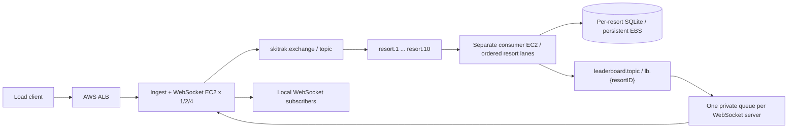
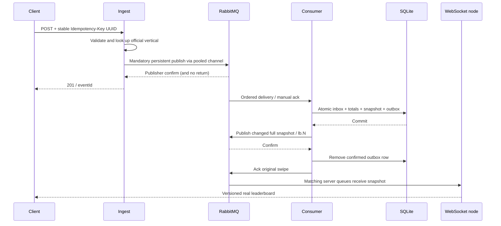

# SkiTrak Assignment 2 architecture

Defaults: Java 11 / Tomcat 9, 10 resorts, Top-N 20. Instructor clarification uses
consumer sweeps 5/10/15/20; values beyond ten useful lanes are expected to plateau.
The official lift mapping is bundled and may be overridden by a validated file.

## Deployment and queue topology

RabbitMQ runs on a dedicated EC2. Durable raw queues bind to `resort.N` and use
TTL 24h, maximum length 100000 and reject-publish overflow by default. The measured
operating target remains depth <1000; capacity/expiration is not a tuning shortcut.
Expired events reach `resort.N.dead` and require investigation. Each raw queue has
a single active consumer; replicas of the broker or consumer are not claimed.

Leaderboard updates use a durable topic exchange and exact routing keys `lb.1`
through `lb.10`. Each WebSocket node owns one exclusive generated queue, binding
only resorts with local subscribers. Notifications are transient complete
snapshots; the durable consumer store is the authoritative bootstrap source.

## Swipe to leaderboard sequence

## Connection locality and concurrency

The topic backplane decouples aggregation ownership from socket ownership, so
ingest and WebSocket nodes scale horizontally. Co-location would reduce one hop
but couple routing, state ownership and node capacity. Topic bindings also avoid
shipping uninterested resorts to every node; they require subscription lifecycle
coordination and an authoritative snapshot endpoint.

On first subscription, the server installs the binding before querying the
snapshot. Live updates and bootstrap responses reconcile by persistent version
per resort/day. Last-unsubscribe, resubscribe and reconnect are serialized and
stale bootstrap responses are discarded. Periodic snapshots repair ephemeral
notification loss. Per-session bounded serial asynchronous sends isolate slow
clients. The backplane does not promise durable replay of every intermediate view.

One FIFO lane owns each resort. A configurable shared worker pool fairly schedules
the ten lanes; its core size may grow/shrink with queue/in-flight load. More than
ten configured threads cannot increase ordered aggregation parallelism. Prefetch
and contiguous per-channel ack batching are configurable; failures retry within
the same lane. Poison/conflicting events pause that partition rather than silently
skip events or reorder later swipes. Top-N uses all-skier totals plus a bounded
ordered set; ties use numeric skier ID and changed displayed scores trigger updates.

Dynamic scaling is on by default (`CONSUMER_DYNAMIC_SCALING=true`, 5 to 10 workers).
Each second the consumer sets the core size to the number of resorts with queued
work, bounded by the minimum and configured thread counts. In the 1M/512-client
run (4 ingests, 2026-11-08 11:03 to 11:09 UTC) the monitor shows the core size
moving between 5 and 10 as load began, 10 active workers with 82,154 ready messages
at 11:04:52, then 8, 6 and 5 at 11:08:45, 11:08:49 and 11:08:51 as the queue drained.
Controlled sweeps disable scaling to hold the worker count fixed. Lane ownership is
not fixed to a thread: any pool thread takes the next message of a free resort lane,
and one resort never has two threads at once.

## Failure handling, ALB and verification

Each producer reuses one connection and a pre-created bounded Channel pool. A
lease is exclusive through publisher confirm. One recovery owner rebuilds the
entire pool after failure; stale leases cannot enter its replacement. Uncertain
publishes return 503 and are retried with the same eventId. Consumer inbox dedupe
and outbox persist across restart on the same EBS volume. Repeated notifications
are harmless because WebSocket nodes discard older/equal versions. No subscribed
queue is a valid notification outcome, not a failed raw swipe.

ALB uses round robin, cookie stickiness, /health every 30s, timeout 5s, healthy=2,
unhealthy=3 and idle timeout 120s. ROOT WAR makes /health directly reachable.
Upgraded WebSocket connections stay on their accepted target; failed sockets
reconnect and bootstrap on another healthy node. systemd/Docker restart failed
processes: on 2026-11-08 the consumer container was killed with `docker kill`
(exit 137, 23:54:04 UTC); systemd restarted it after its 5 s delay and `/health`
returned 200 by 23:54:11, about 7 s in all, with the processed count unchanged at
30,692,311. Broker, consumer and management traffic stays on private networks or
SSH tunnels; real credentials stay in ignored env files.

Validation separates HTTP acceptance from pipeline completion and verifies final
business totals/Top-N, repeated IDs, cross-node sockets, restart and reconnect.
Cloud runs: 500K at 1/2/4 ingest nodes plus 1M at four; record client latency and
throughput, queue depth/rates, lag, host resources and ALB distribution. Synchronize
clocks before interpreting cross-host latency. SQLite FULL durability and
confirmed ordered broadcasts are explicit throughput tradeoffs to measure. Final
measured configuration uses STORE_BATCH_SIZE=64, a10ms partial-batch flush
trigger, PREFETCH_COUNT=128, ACK_BATCH_SIZE=16, and CHANNEL_POOL_SIZE=64.
Snapshots are rewritten only for changed Top-N standings; every changed version
is retained for ordered publication. Controlled consumer sweeps disable automatic
scaling. Four-ingest500K/128-client/20-worker measurements show a sampled raw
queue total peak253 and mean lag25.61ms; four-ingest1M/512-client stress misses
queue and lag targets. Detailed evidence and limitations are in
`output/assignment2-report.md`. Persistent-disk
loss, TTL expiration and multi-consumer-host HA require additional design; this
implementation does not claim to solve those failures.
