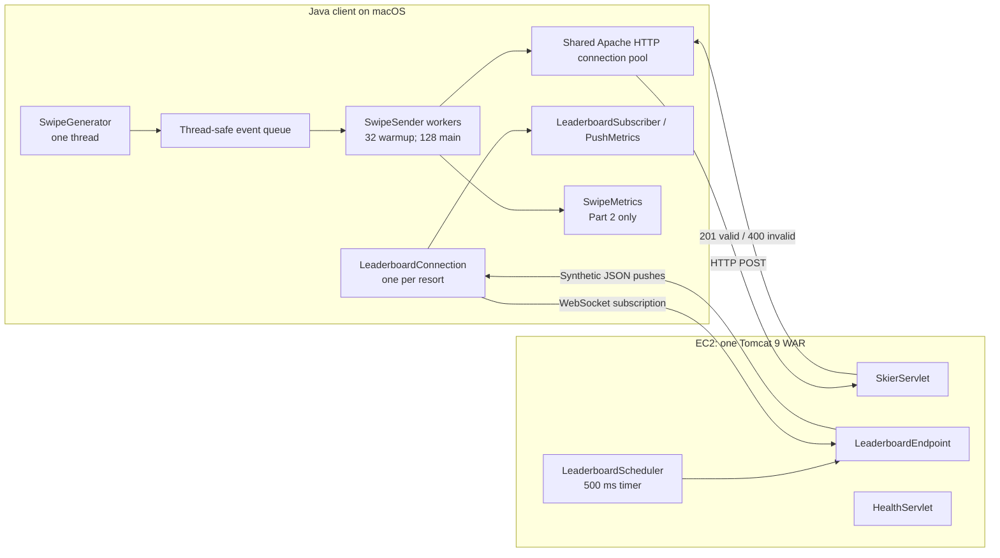

# SkiTrak — Assignment 1 Design

## Architecture

The system consists of a Java load client running on macOS and one
Java 11 / Tomcat 9 server deployed on EC2 in us-west-2.

The server is packaged as a single WAR containing the swipe-ingest
servlet, health servlet, and WebSocket leaderboard endpoint. It validates
and acknowledges swipes without storing or aggregating skier data.
Leaderboard messages contain synthetic standings independent of swipes.

## Major classes and relationships

- `LoadClient` coordinates event generation, subscriptions, warmup,
  main-phase workers, resource cleanup, and final metrics.
- `SwipeGenerator` creates immutable `SwipeEvent` objects and places
  them in an `ArrayBlockingQueue`.
- `SwipeSender` removes events from the queue and sends them through
  the shared `HttpTransport`, applying application-level retries.
- `HttpTransport` owns the Apache HTTP connection pool and records
  connection and request-attempt statistics.
- `LeaderboardConnection` manages one resort subscription and schedules
  reconnection. Its `LeaderboardSubscriber` receives complete messages
  and records their timestamps through `PushMetrics`.
- In Client Part 2, `SwipeMetrics` records HTTP attempts, exports CSV,
  and calculates latency statistics and throughput per resort.
- On the server, `SkierServlet` validates swipes, `HealthServlet`
  reports status, and `LeaderboardScheduler` invokes
  `LeaderboardEndpoint` to broadcast synthetic standings.

## Threading model

One dedicated generator thread creates all 500000 events before HTTP
workers start. The main thread joins the generator and checks that the
queue contains the expected number of events. Senders use nonblocking
queue polling, so they never wait for event generation.

Pre-generation simplifies coordination and avoids producer starvation,
at the cost of memory proportional to the number of events. Generation
time is reported separately from ingest time.

Warmup uses a fixed pool of 32 workers. Each worker processes 1000
logical events, giving 32000 warmup events. After all warmup workers
terminate, a new pool of 128 workers processes the remaining 468000.
Both phases reuse the same HTTP connection pool.

Worker futures and event-count invariants detect incomplete phases.
Successful and finally failed logical events are counted separately
from HTTP attempts and retries.

One WebSocket subscription is established for each configured resort
before ingest begins. Subscriptions remain active through both phases,
and each connection has a scheduler for reconnect attempts. Cleanup
closes subscriptions and the HTTP transport when the run ends.

## Connection management and error handling

All HTTP senders share one Apache HttpClient connection pool. Its total
and per-route capacity is max(32, mainThreads), allowing both phases to
reuse connections. Responses are fully consumed before connections
return to the pool.

Automatic library retries are disabled. Each logical event has one
initial attempt and at most five application retries, with delays of
100, 200, 400, 800, and 1600 ms. An event is counted as failed only after
all attempts fail. Retrying an ambiguous network failure can duplicate
a server-side request; the assignment's dummy server does not persist
events.

HTTP metrics distinguish pool occupancy, cumulative successful TCP
connections, and application retries. New TCP connections opened during
application retries are reported as a limited recovery metric; this
does not count every replacement connection.

Each resort has a persistent WebSocket connection. Close/error callbacks
schedule reconnection with exponential backoff capped at 16 seconds.
Synchronized state prevents duplicate connection attempts, and generation
tokens reject stale callbacks. Successful connections after the first
are counted as reconnections. Shutdown cancels reconnect scheduling and
aborts active sockets.

## Measurement design

Client Part 2 records send and completion timestamps, monotonic elapsed
time, status code, and resort ID for every HTTP attempt. It exports CSV
after ingest and calculates mean, median, p95, p99, minimum, maximum,
and throughput per resort. Retry delays are excluded from individual
attempt latency but included in ingest runtime.

Push measurements retain the server timestamp and client receipt time
for each complete, parsed message. Their difference includes clock
offset between machines. Negative values are preserved and cannot be
interpreted as negative network transit time.

The throughput chart counts successful responses by completion time
in 10-second buckets. It includes warmup and uses the actual duration
of the final partial bucket.

## Little's Law and thread-count choice

The sequential Apache client measured a fresh-client request of
295.246 ms and a pooled mean response time of 27.444 ms. The fresh
request includes connection and startup overhead, so it is not a pure
TCP handshake measurement.

For synchronous workers with one outstanding request each, the planning
estimate is X = N / R. With 128 workers:

X ≈ 128 / 0.027444 ≈ 4664 events/s.

The recorded main-phase results were:

| Client | Main throughput (events/s) | Prediction achieved |
|---|---:|---:|
| Part 1 | 3644.80 | 78.1% |
| Part 2 | 3449.67 | 74.0% |

Main-phase throughput is used because warmup has only 32 workers.
The estimate assumes sequential response time remains representative
under concurrency. Scheduling, contention, network variation, connection
replacement, and client processing may increase request-cycle time.
These experiments do not isolate each contributor.

128 workers was selected using earlier JDK HttpClient runs comparing
32, 64, and 128 workers. It is not claimed to be the proven optimum
for Apache HttpClient.

## Validation scope

Both Apache/Java 11 clients completed 500000 events with zero final
failures and zero application retries. These full runs preceded the
final server redeployment and minor client configuration/output changes.

Subsequent 5000-event checks verified two-resort configuration and the
Part 1 connection-time summary. After server redeployment, health,
selected POST boundary cases, and synthetic WebSocket pushes were
verified separately. The full performance runs have not been repeated
against that final WAR.