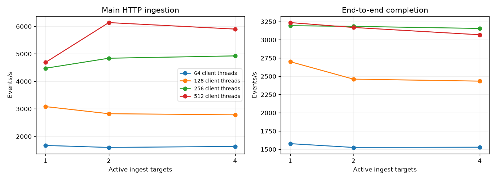

# Assignment 2 - Fresh performance analysis

## Verified findings and limitations

The 17 runs sent and processed 9,000,000 events, with zero final failed requests, zero additional duplicates and 269 application retries. Every recorded final Ready/in-flight/outbox count was zero. The 4-ingest 500K/512 run improved main HTTP throughput by 25.80% versus one ingest, while end-to-end throughput fell by 5.16%. The 1M/512 run had Ready peak 377,327, mean Consumer lag 49,377.24 ms, 110.256 seconds of drain/verification and 77 retries. These overload runs did not meet the queue-depth or lag targets.

The 1M ingest-counter deltas cover only 3,716 requests, rather than the full 1,000,077 client attempts. The cause of the mismatch is unresolved, so that distribution chart is not used to claim whole-run balance. The 4-ingest 500K/512 counters record 124,998 / 125,000 / 125,000 / 125,002 attempts and provide a complete balanced-distribution observation.

The 1M Consumer mean I/O wait was 41.39%, with mean OS-observed writes of 4,842.87 IOPS; RabbitMQ mean CPU was 54.74%. These support downstream storage/processing pressure without proving an exclusive EBS IOPS bottleneck. Dynamic scaling was disabled for the fixed-worker sweep, so that experiment does not validate its adaptive behavior.

Corrected two- and four-ingest CloudWatch captures are included. Per-run Consumer sweeps retain automatic broker/system evidence but have no separately supplied ALB CloudWatch captures. The single-target console image shows the deregistration transition; routing probes provide separate evidence of the active single-ingest topology. AI reflection text is a factual draft requiring student review; local A2 publication to the configured Git remote has not been verified.

## Benchmark results

| Ingests | Events | Client threads | Workers | HTTP main/s | End-to-end/s | HTTP p99 ms | Retries | Ready peak | Mean lag ms |
|---|---:|---:|---:|---:|---:|---:|---:|---:|---:|
| 1 | 500000 | 64 | 10 | 1,666.74 | 1,576.41 | 93.47 | 0 | 0 | 19.66 |
| 1 | 500000 | 128 | 10 | 3,080.16 | 2,699.50 | 134.59 | 0 | 0 | 25.18 |
| 1 | 500000 | 256 | 10 | 4,475.42 | 3,192.84 | 275.29 | 6 | 55,463 | 5,177.43 |
| 1 | 500000 | 512 | 10 | 4,689.51 | 3,235.22 | 469.87 | 131 | 59,967 | 7,135.63 |
| 2 | 500000 | 64 | 10 | 1,594.86 | 1,524.64 | 153.19 | 0 | 0 | 18.22 |
| 2 | 500000 | 128 | 10 | 2,821.24 | 2,460.44 | 191.59 | 0 | 29 | 29.39 |
| 2 | 500000 | 256 | 10 | 4,839.15 | 3,183.52 | 272.08 | 0 | 68,120 | 9,306.91 |
| 2 | 500000 | 512 | 10 | 6,135.42 | 3,168.37 | 314.39 | 55 | 145,164 | 16,665.74 |
| 4 | 500000 | 64 | 10 | 1,631.83 | 1,527.74 | 155.48 | 0 | 0 | 18.87 |
| 4 | 500000 | 128 | 10 | 2,781.22 | 2,433.20 | 202.31 | 0 | 26 | 24.43 |
| 4 | 500000 | 256 | 10 | 4,924.34 | 3,154.89 | 194.77 | 0 | 80,309 | 7,641.57 |
| 4 | 500000 | 512 | 10 | 5,899.50 | 3,068.38 | 331.42 | 0 | 141,495 | 13,798.40 |
| 4 | 1000000 | 512 | 10 | 6,551.14 | 3,323.33 | 312.63 | 77 | 377,327 | 49,377.24 |
| 4 | 500000 | 128 | 5 | 2,604.84 | 2,275.86 | 241.01 | 0 | 138 | 42.40 |
| 4 | 500000 | 128 | 10 | 3,155.08 | 2,650.72 | 92.10 | 0 | 446 | 34.96 |
| 4 | 500000 | 128 | 15 | 3,032.48 | 2,643.07 | 93.09 | 0 | 1,059 | 38.50 |
| 4 | 500000 | 128 | 20 | 3,036.31 | 2,620.63 | 99.31 | 0 | 111 | 39.38 |

## Scaling comparison and interpretation

The following compares the latest completed scaling observation for each node/thread configuration with the corresponding single-ingest run. All attempts remain listed in this report; observations are not selected by best throughput. Persistent database/cache state and time of day differ, so percentage changes are descriptive rather than statistically established causal effects.

| Client threads | Ingests | Main HTTP change vs1 | End-to-end change vs1 |
|---|---:|---:|---:|
| 64 | 2 | -4.31% | -3.28% |
| 64 | 4 | -2.09% | -3.09% |
| 128 | 2 | -8.41% | -8.86% |
| 128 | 4 | -9.71% | -9.86% |
| 256 | 2 | +8.13% | -0.29% |
| 256 | 4 | +10.03% | -1.19% |
| 512 | 2 | +30.83% | -2.07% |
| 512 | 4 | +25.80% | -5.16% |

If main HTTP throughput rises while end-to-end throughput changes little and queues/drain grow, the improvement is at ingestion rather than completed processing. Conversely, little scaling at low client concurrency may reflect the admitted workload rather than a saturated ingest. Neither high average I/O wait nor a brief broker CPU peak alone identifies an exclusive bottleneck.

Fixed-worker comparisons must consider both lag and queue depth alongside throughput. Ten ordered resort queues cap useful aggregation parallelism at ten; configuring 15/20 workers does not create15/20 independent resort lanes. Sampled bounds and mean lag do not prove per-event limits.

