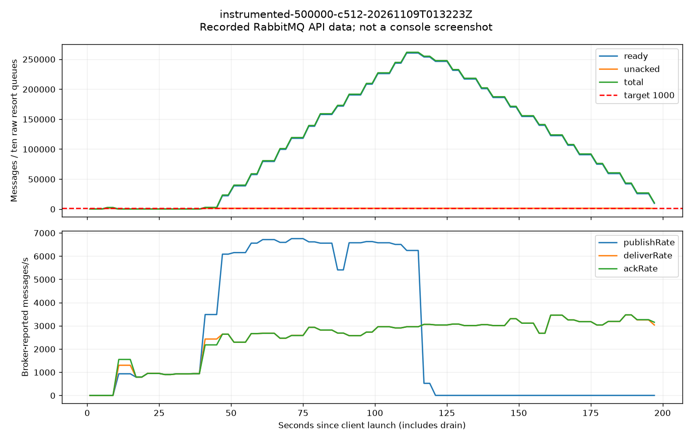
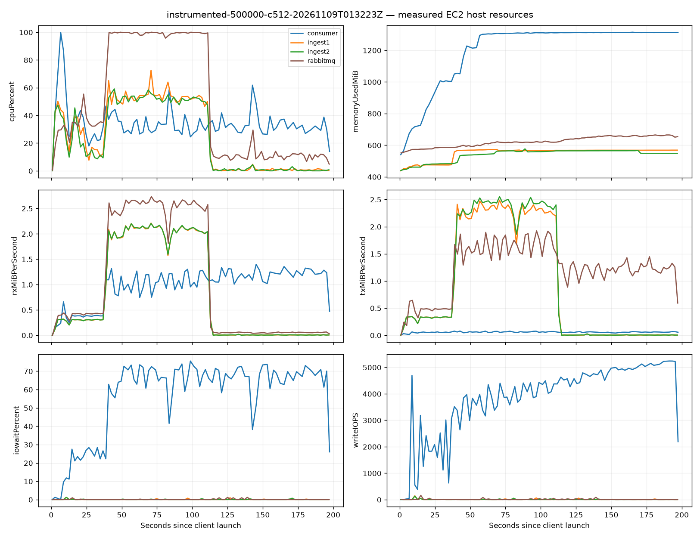
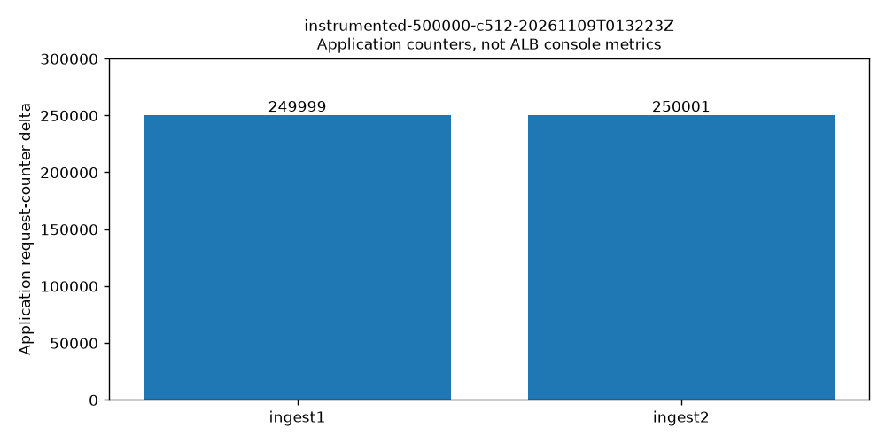
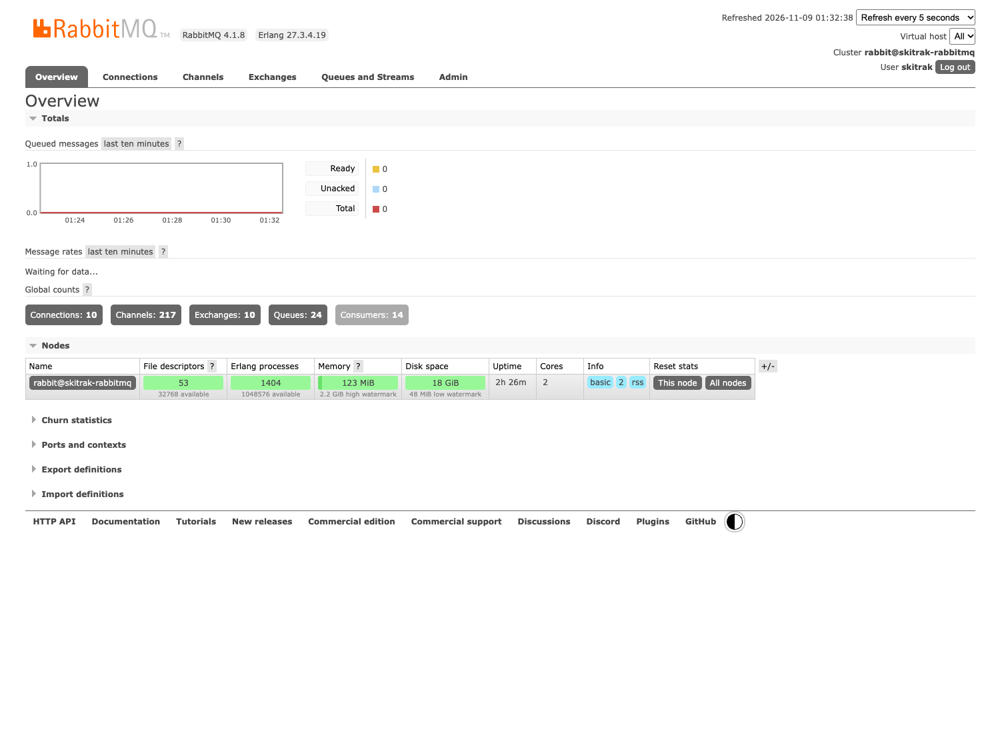
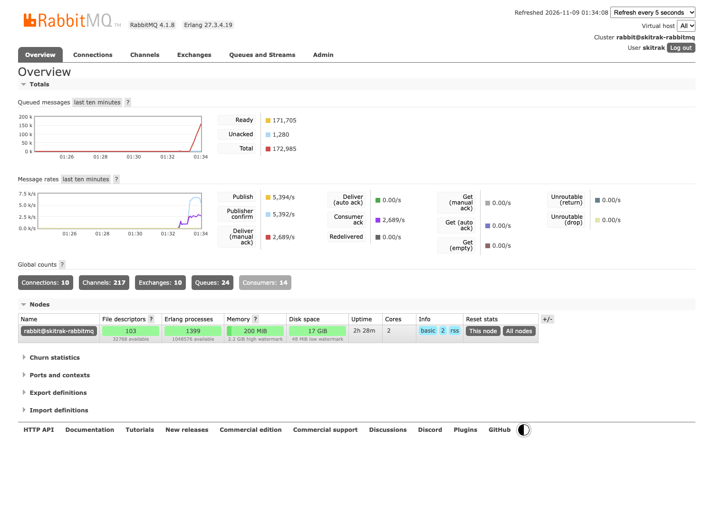
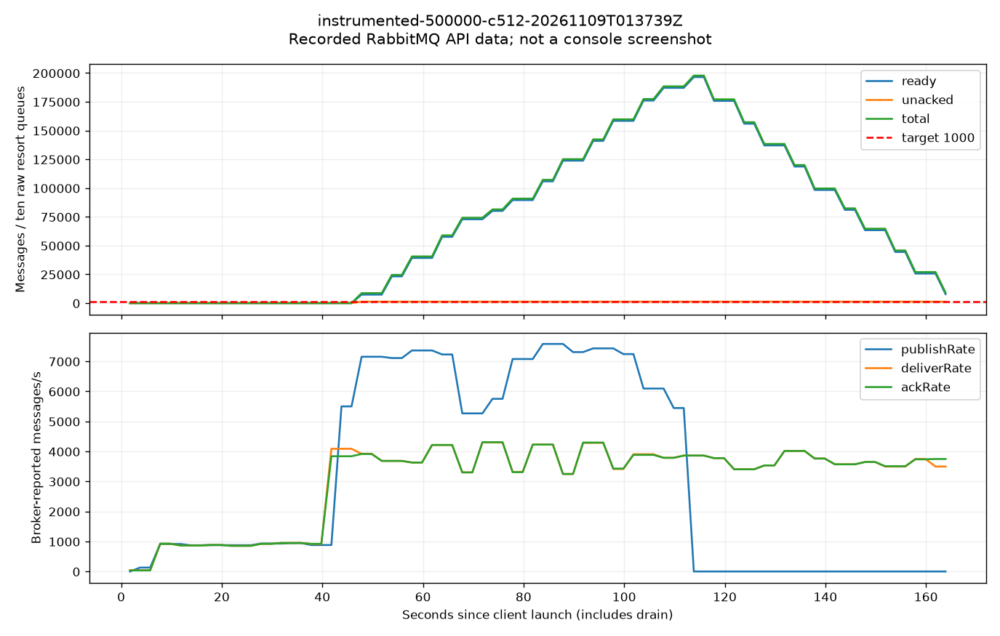
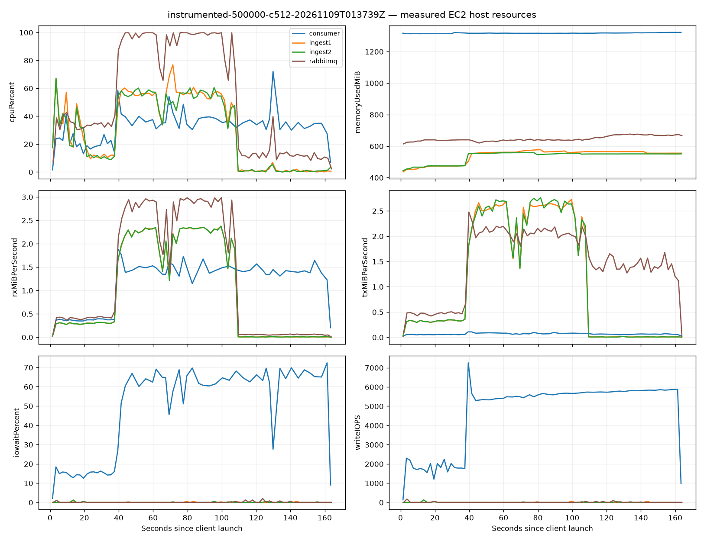
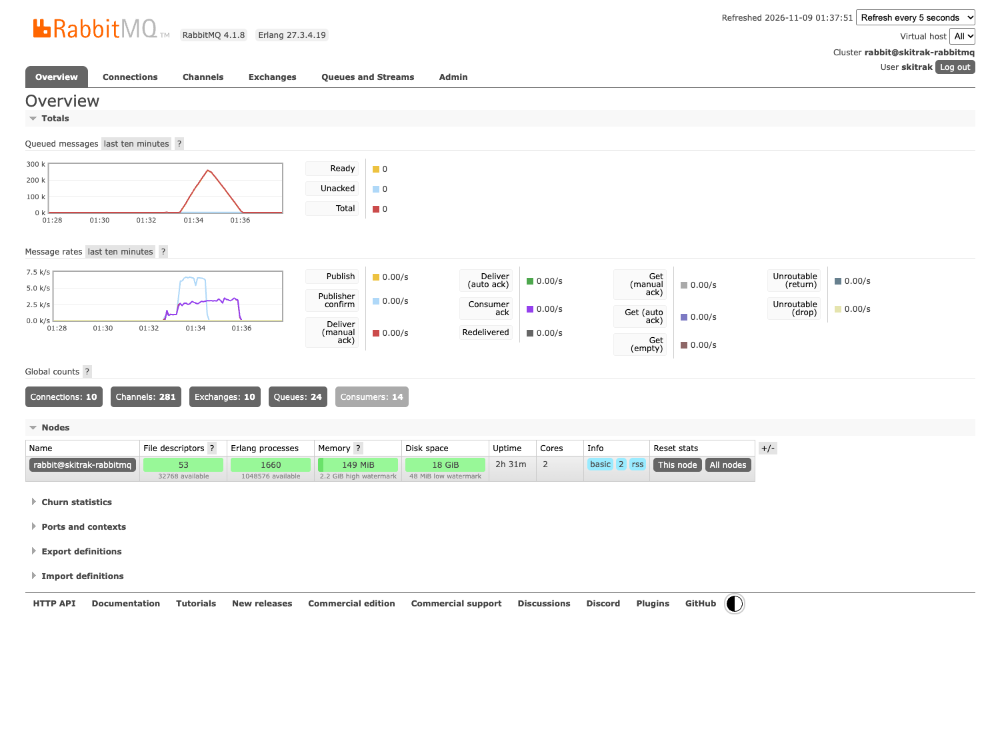
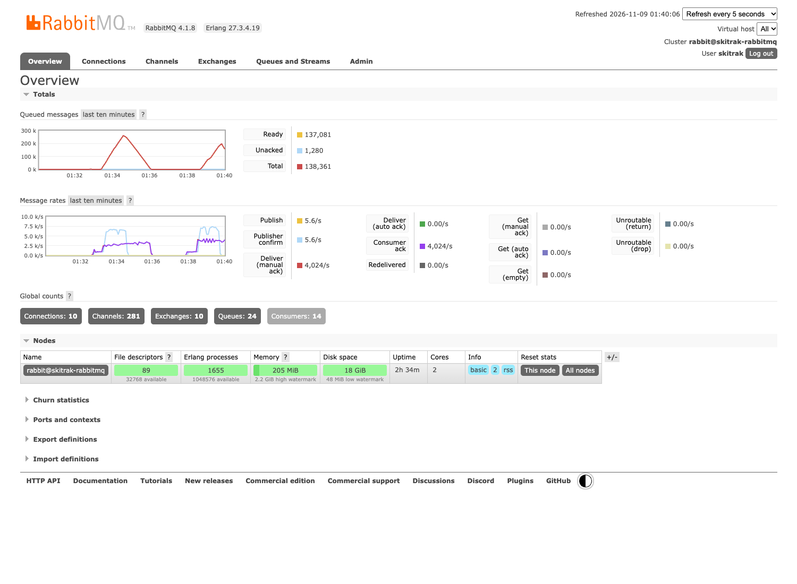
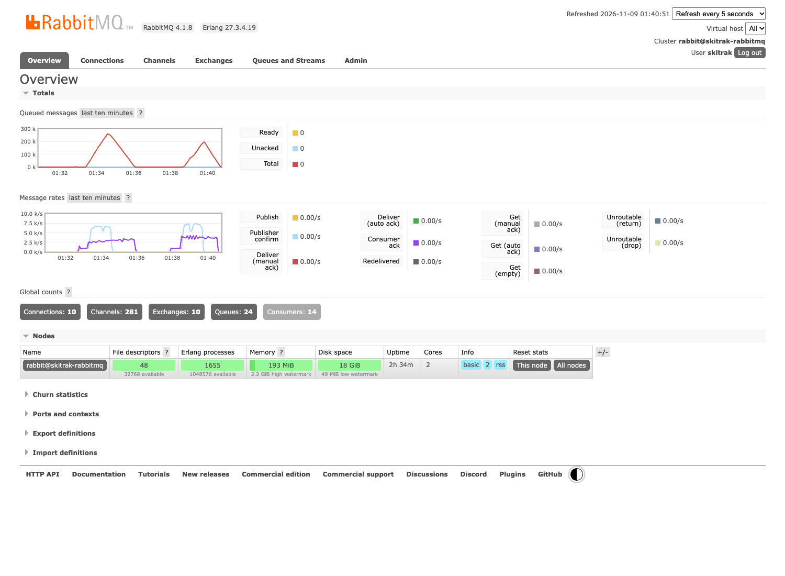

# Channel pool size: repeated comparison

Two ingests; 500,000 events per run; 512 client threads; 10 fixed Consumer workers; prefetch 128; ACK batch 16; DB batch 64 with a 10 ms flush trigger. Seed 6650, ten resorts, Top-N 20. Pool 32 runs before pool 64. Persistent database and cache state are retained, so differences are descriptive observations from one run per setting.

| Pool | Main HTTP/s | End-to-end/s | HTTP p99 ms | Retries | Final failures | Ready peak | Ready + Unacked peak | Mean lag ms |
|---|---:|---:|---:|---:|---:|---:|---:|---:|
| 32 | 6,344.82 | 2,559.25 | 271.70 | 0.00 | 0.00 | 260,244.00 | 261,524.00 | 42,884.24 |
| 64 | 6,677.33 | 3,097.55 | 272.78 | 58.00 | 0.00 | 196,473.00 | 197,753.00 | 24,390.37 |

Ready and Total are different queue measures. Peaks and rates are sampled over the client window, including warmup and drain. Mean lag does not prove a per-event latency bound. Application request counters provide distribution evidence; they are not AWS per-target CloudWatch measurements.

## Pool 32

Client UTC window: **2026-11-09T01:32:39.401542+00:00 – 2026-11-09T01:35:58.165305+00:00**.

[Full client output](evidence/instrumented-500000-c512-20261109T013223Z/client-output.txt) | [Recorded metrics and limitations](evidence/instrumented-500000-c512-20261109T013223Z/summary.json)

Publisher counters: `{"ingest1": {"failureReasonDeltas": {"ACQUIRE_TIMEOUT": 0, "BROKER_NACK": 0, "CONFIRM_TIMEOUT": 0, "INTERRUPTED": 0, "PUBLISH_ERROR": 0, "UNROUTABLE": 0}, "initialAvailableChannels": 32, "publishConfirmedDelta": 249999, "publishFailedDelta": 0, "requestAttemptDelta": 249999}, "ingest2": {"failureReasonDeltas": {"ACQUIRE_TIMEOUT": 0, "BROKER_NACK": 0, "CONFIRM_TIMEOUT": 0, "INTERRUPTED": 0, "PUBLISH_ERROR": 0, "UNROUTABLE": 0}, "initialAvailableChannels": 32, "publishConfirmedDelta": 250001, "publishFailedDelta": 0, "requestAttemptDelta": 250001}}`

Collection gaps: consumer collection errors: {"timeout": 5}

## Pool 64

Client UTC window: **2026-11-09T01:37:53.138892+00:00 – 2026-11-09T01:40:37.698745+00:00**.

[Full client output](evidence/instrumented-500000-c512-20261109T013739Z/client-output.txt) | [Recorded metrics and limitations](evidence/instrumented-500000-c512-20261109T013739Z/summary.json)

Publisher counters: `{"ingest1": {"failureReasonDeltas": {"ACQUIRE_TIMEOUT": 58, "BROKER_NACK": 0, "CONFIRM_TIMEOUT": 0, "INTERRUPTED": 0, "PUBLISH_ERROR": 0, "UNROUTABLE": 0}, "initialAvailableChannels": 64, "publishConfirmedDelta": 249970, "publishFailedDelta": 58, "requestAttemptDelta": 250028}, "ingest2": {"failureReasonDeltas": {"ACQUIRE_TIMEOUT": 0, "BROKER_NACK": 0, "CONFIRM_TIMEOUT": 0, "INTERRUPTED": 0, "PUBLISH_ERROR": 0, "UNROUTABLE": 0}, "initialAvailableChannels": 64, "publishConfirmedDelta": 250030, "publishFailedDelta": 0, "requestAttemptDelta": 250030}}`

Collection gaps: consumer collection errors: {"timeout": 11}

## AWS console evidence

Run-matched AWS ALB screenshots are collected separately using these client UTC windows: whole-LoadBalancer RequestCount (Sum) and TargetResponseTime (Average), 60-second period. Do not reuse an earlier run screenshot. AWS statistics use minute buckets and may include boundary activity; exact successful/retry counts come from the client log.
