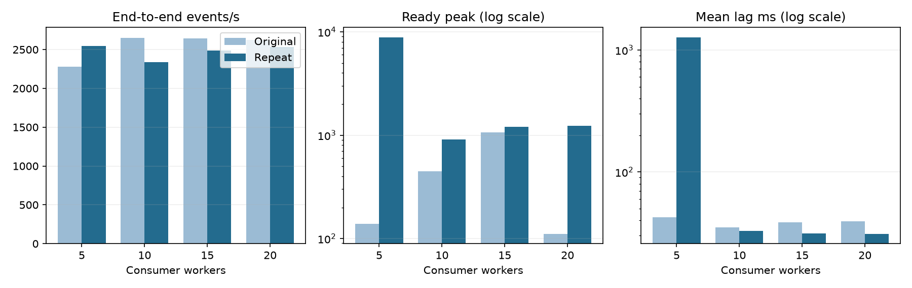
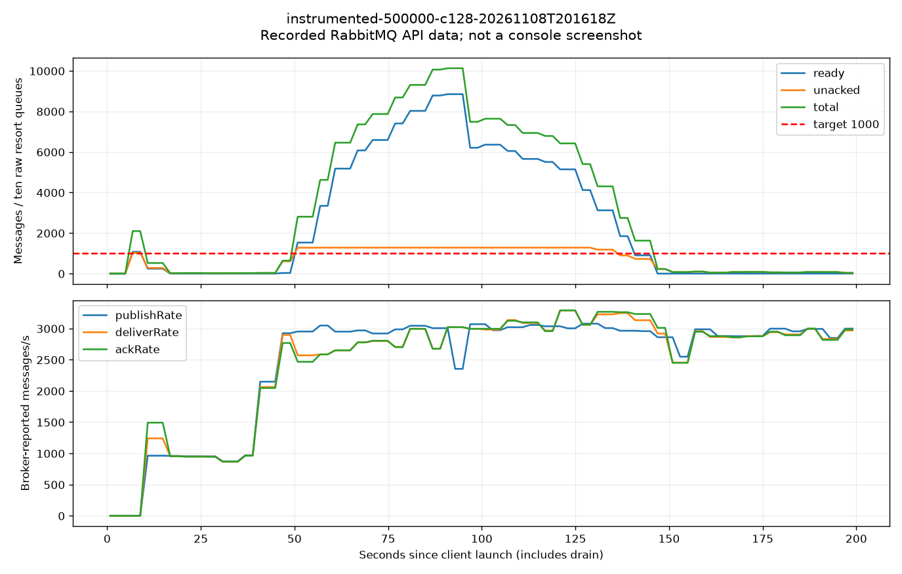
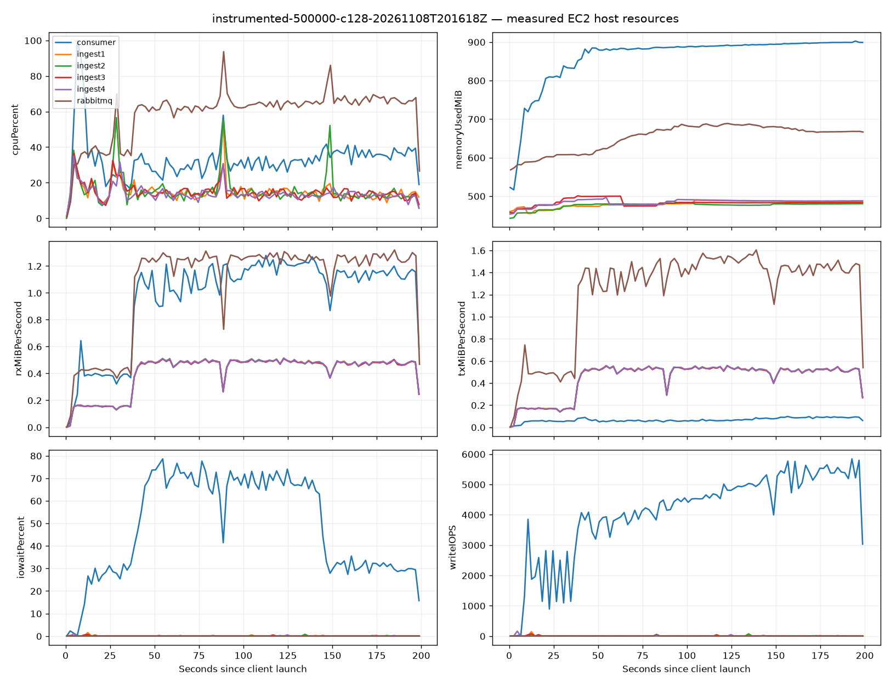
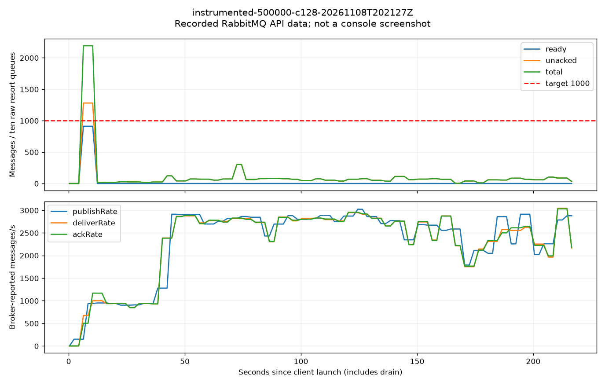
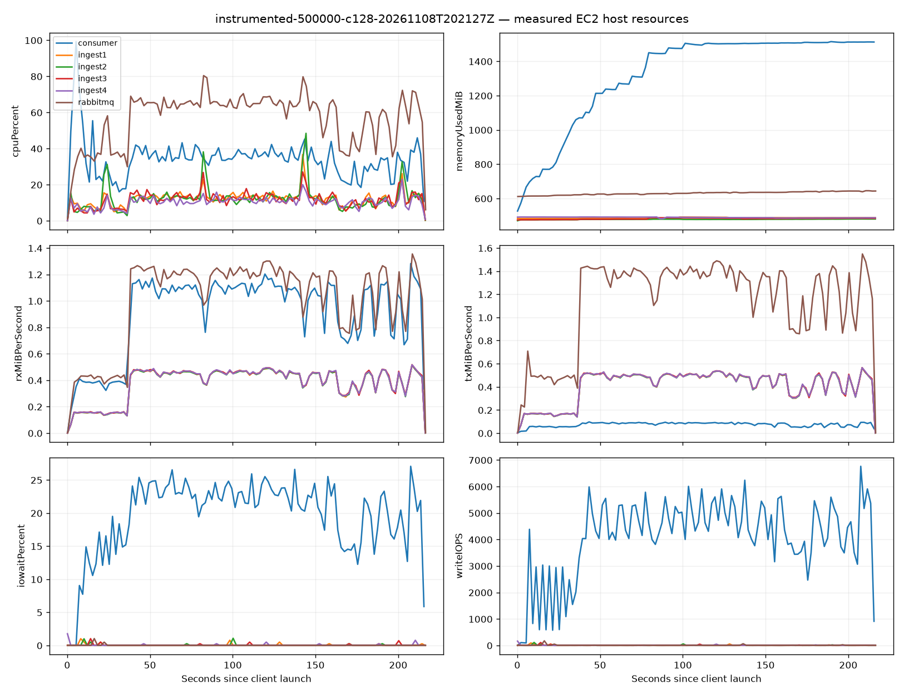
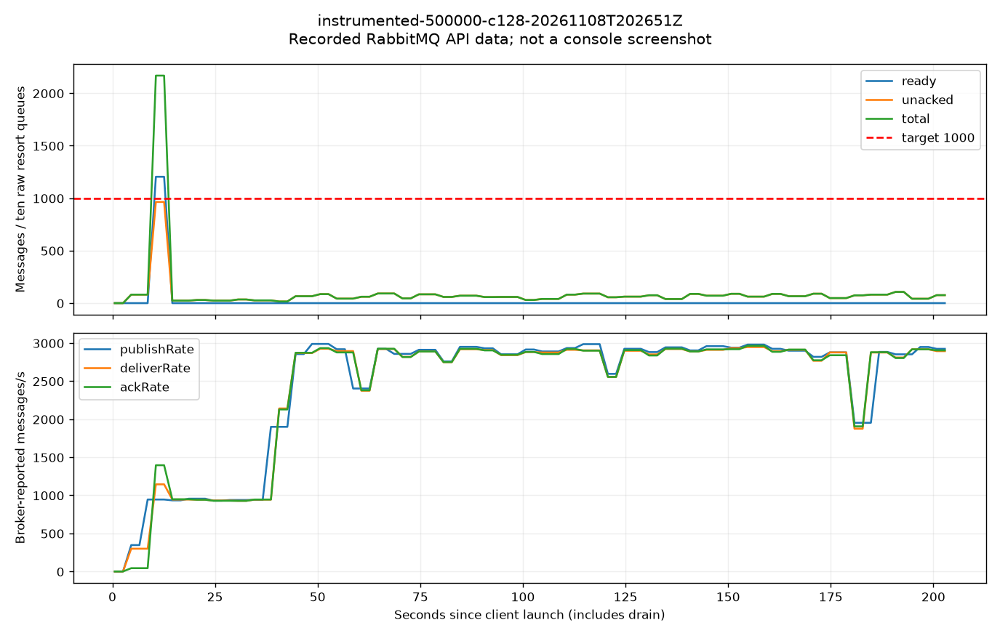
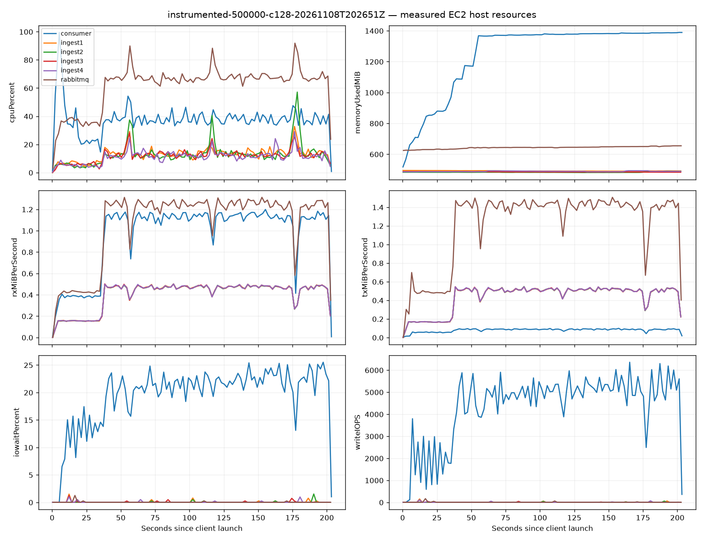
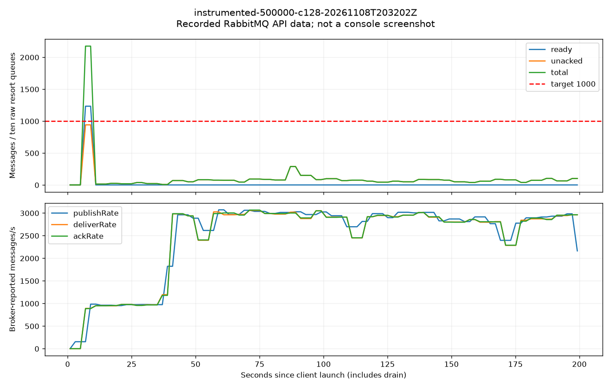
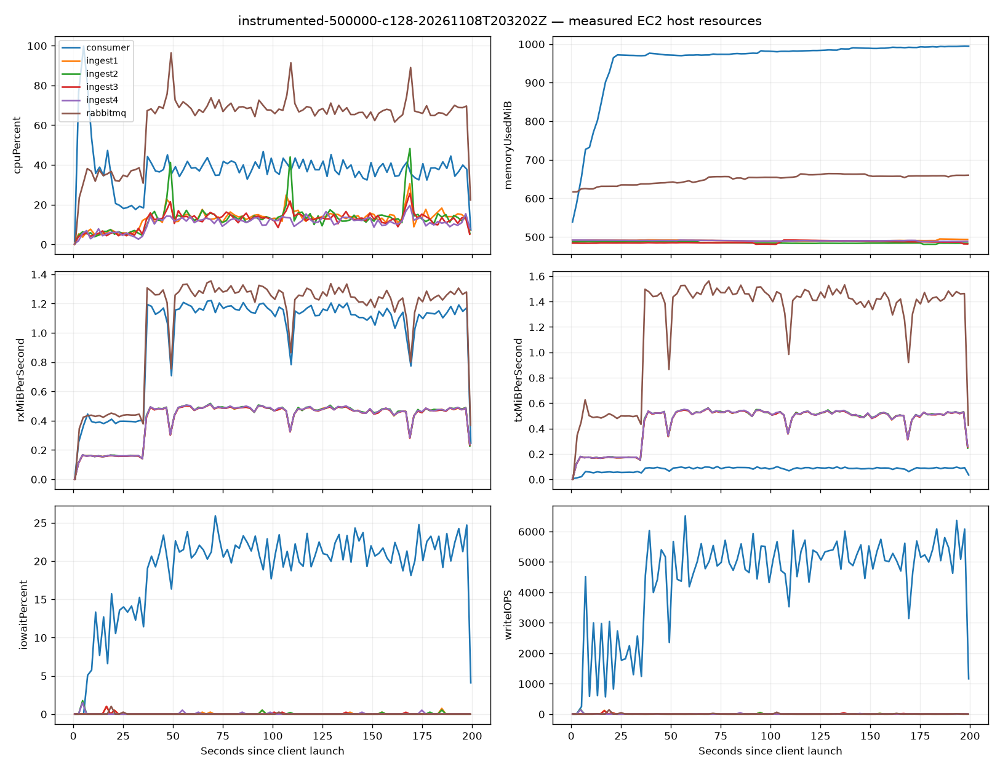

# Fixed-worker sweep: original and repeat

Four ingests, 500,000 events per run, 128 client threads, 10 resorts, Top-N 20, seed 6650. Only worker count changes within this repeat. Persistent database state is retained. The original and repeat are separated by an EC2 stop/start, so cache, accumulated data and CPU-credit state may differ. These are repeated observations, not an isolated causal experiment. Both runs are retained; no best-result selection.

Queue depth is reported both as Ready and Ready + Unacked. Means/peaks are sampled over the client window including warmup and drain. Mean lag is not a per-event maximum.

| Workers | Observation | HTTP main/s | End-to-end/s | HTTP p99 ms | Retries | Ready peak | Ready+Unacked peak | Mean lag ms |
|---|---|---:|---:|---:|---:|---:|---:|---:|
| 5 | Original | 2,604.84 | 2,275.86 | 241.01 | 0.00 | 138.00 | 1,380.00 | 42.40 |
| 5 | Repeat | 2,906.54 | 2,548.57 | 78.44 | 0.00 | 8,848.00 | 10,128.00 | 1,268.99 |
| 10 | Original | 3,155.08 | 2,650.72 | 92.10 | 0.00 | 446.00 | 1,726.00 | 34.96 |
| 10 | Repeat | 2,630.00 | 2,338.03 | 192.48 | 0.00 | 911.00 | 2,191.00 | 32.93 |
| 15 | Original | 3,032.48 | 2,643.07 | 93.09 | 0.00 | 1,059.00 | 2,192.00 | 38.50 |
| 15 | Repeat | 2,826.24 | 2,487.89 | 86.22 | 0.00 | 1,204.00 | 2,168.00 | 31.22 |
| 20 | Original | 3,036.31 | 2,620.63 | 99.31 | 0.00 | 111.00 | 1,346.00 | 39.38 |
| 20 | Repeat | 2,872.71 | 2,534.38 | 84.47 | 0.00 | 1,233.00 | 2,174.00 | 31.07 |

## Change from the original observation

| Workers | End-to-end throughput change | Original mean lag ms | Repeat mean lag ms | Original Ready peak | Repeat Ready peak |
|---|---:|---:|---:|---:|---:|
| 5 | +11.98% | 42.40 | 1,268.99 | 138.00 | 8,848.00 |
| 10 | -11.80% | 34.96 | 32.93 | 446.00 | 911.00 |
| 15 | -5.87% | 38.50 | 31.22 | 1,059.00 | 1,204.00 |
| 20 | -3.29% | 39.38 | 31.07 | 111.00 | 1,233.00 |

## Cache-state evidence

| Workers | Consumer device reads MiB | Mean device read IOPS |
|---|---:|---:|
| 5 | 1,072.65 | 1,351.13 |
| 10 | 149.11 | 166.30 |
| 15 | 24.01 | 28.36 |
| 20 | 4.48 | 5.33 |

Device read workload differs between sequential observations. Declining reads are consistent with cache warming; a lag difference therefore cannot be attributed only to worker count. These are OS device counters over the sampled client window, not EBS CloudWatch IOPS. Tests retain their original sequential order and do not randomize or reset cache state.

Each worker configuration now has two observations. This remains too little evidence to attribute every change to the worker count. Mean lag below 100 ms does not establish every-event latency below 100 ms. The Ready threshold and Ready + Unacked threshold must be interpreted separately.

## Repeat evidence and validation

### 5 workers

UTC: 2026-11-08T20:16:34.626029+00:00 to 2026-11-08T20:19:54.404703+00:00

Successful=500000, finalFailed=0, retries=0, processedDelta=500000, duplicates=0. Final Ready/in-flight/outbox=0/0/0.

[Client output](evidence/instrumented-500000-c128-20261108T201618Z/client-output.txt) | [Metrics](evidence/instrumented-500000-c128-20261108T201618Z/summary.json)

Collection gaps: consumer collection errors: {"timeout": 1}

### 10 workers

UTC: 2026-11-08T20:21:39.768232+00:00 to 2026-11-08T20:25:16.749176+00:00

Successful=500000, finalFailed=0, retries=0, processedDelta=500000, duplicates=0. Final Ready/in-flight/outbox=0/0/0.

[Client output](evidence/instrumented-500000-c128-20261108T202127Z/client-output.txt) | [Metrics](evidence/instrumented-500000-c128-20261108T202127Z/summary.json)

Collection gaps: None detected.

### 15 workers

UTC: 2026-11-08T20:27:06.061959+00:00 to 2026-11-08T20:30:29.855984+00:00

Successful=500000, finalFailed=0, retries=0, processedDelta=500000, duplicates=0. Final Ready/in-flight/outbox=0/0/0.

[Client output](evidence/instrumented-500000-c128-20261108T202651Z/client-output.txt) | [Metrics](evidence/instrumented-500000-c128-20261108T202651Z/summary.json)

Collection gaps: None detected.

### 20 workers

UTC: 2026-11-08T20:32:14.440919+00:00 to 2026-11-08T20:35:34.212366+00:00

Successful=500000, finalFailed=0, retries=0, processedDelta=500000, duplicates=0. Final Ready/in-flight/outbox=0/0/0.

[Client output](evidence/instrumented-500000-c128-20261108T203202Z/client-output.txt) | [Metrics](evidence/instrumented-500000-c128-20261108T203202Z/summary.json)

Collection gaps: None detected.

## Interpretation of the repeat

The five-worker repeat had higher throughput than its original observation but also much higher Ready backlog and mean lag. Ten workers kept the sampled Ready peak below 1,000 with mean lag below 100 ms; fifteen and twenty workers had mean lag near 31 ms but Ready peaks above 1,000. All repeated configurations exceeded 1,000 if Ready + Unacked is used. Final failures and application retries were zero in all four repeated runs.

Throughput is not monotonic in worker count: 5/10/15/20 yielded 2,548.57 / 2,338.03 / 2,487.89 / 2,534.38 end-to-end events/s. This does not establish that five workers have the greatest sustainable capacity. Actual admitted rates and cache/read workload differed. Ten ordered resort queues cap useful aggregation parallelism at ten; extra threads did not create extra resort lanes.

Completion validation: 2,000,000 unique events processed, zero added duplicates, final pipeline drained, and Consumer restored to ten fixed workers. See validation.json for the saved-suite count reconciliation and separate post-restart health check. The original formal report and PDF are preserved; this repeat is a separate comparison, not a replacement of earlier observations.
