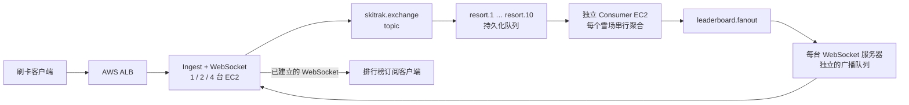

# 总结作业要求与架构建议

> 这是这个项目本周作业，请总结一下需要做的内容，并提供工业化设计的架构和代码逻辑建议
>
> User context
>
> Attachments:
> - assignment2.md: `~/Downloads/assignment2.md`

<details><summary>9 previous messages</summary>

> 我先阅读作业要求和项目现状，再整理必做内容、架构设计和代码实现建议。
>
> <details><summary>Explored a file, ran a command</summary>
>
> <details><summary>Explored a file</summary>
>
> - Read `~/Downloads/assignment2.md`
>
> </details>
>
> - Ran `pwd && rg --files -g 'AGENTS.md' -g 'README*' -g 'pom.xml' -g 'build.gradle*' -g 'package.json' -g 'go.mod' -g '*.java' -g '*.proto' -g 'docker-compose*' -g '*terraform*' -g '*.tf' -g '*.md' -g '!target' -g '!node_modules'`
>
> </details>
>
> <details><summary>Explored a search, ran 2 commands</summary>
>
> - Ran `rg --files -g 'AGENTS.md' -g '.agents/**' -g '!*target*' -g '!node_modules' -g '!results/**' && cat README.md DESIGN.md server/pom.xml server/src/main/java/SkierServlet.java server/src/main/java/LeaderboardEndpoint.java server/src/main/java/LeaderboardScheduler.java server/src/main/java/HealthServlet.java`
>
> - Ran `git status --short && ls -la`
>
> <details><summary>Explored a search</summary>
>
> - Searched for `vertical|lift|eventId|UUID|timestamp|serverId|topN|dayID|dayId|resortID|resortId|retry|retries|WebSocket` in `server`
>
> </details>
>
> </details>
>
> <details><summary>Ran 2 commands, searched the web</summary>
>
> - Ran `cat README.md DESIGN.md server/pom.xml server/src/main/java/SkierServlet.java server/src/main/java/LeaderboardEndpoint.java server/src/main/java/LeaderboardScheduler.java server/src/main/java/HealthServlet.java`
>
> - Ran `cat client-part2/src/main/java/SwipeEvent.java client-part2/src/main/java/SwipeSender.java client-part2/src/main/java/LeaderboardSubscriber.java && rg --files --hidden -g '*[Ll]ift*' -g '*[Vv]ertical*' -g '*.csv' -g '*.json' -g '*.yml' -g '*.yaml' -g '!**/.git/**' -g '!client-part*/results/**' -g '!results/**' -g '!**/target/**'`
>
> Searched the web for `site.rabbitmq.com docs java client guide channel sharing publisher confirms automatic recovery ordering single active consumer ...`
>
> </details>
>
> 作业的核心是把刷卡事件可靠地送进队列、正确聚合，再把真实榜单送到持有 WebSocket 连接的服务器。当前项目的客户端和连接管理可以复用；服务端仍是直接返回 201、定时推送固定榜单。我也发现两个设计上要处理的地方：10 个雪场队列限制了有序聚合的并行度；队列 TTL 和容量限制需要与“不丢刷卡”目标一起设计。
>
> <details><summary>Explored 8 files, searched the web</summary>
>
> <details><summary>Explored 8 files</summary>
>
> - Read `./server/src/main/java/SkierServlet.java`
> - Read `./server/src/main/java/LeaderboardEndpoint.java`
> - Read `./server/src/main/java/LeaderboardScheduler.java`
> - Read `./server/src/main/java/HealthServlet.java`
> - Read `./client-part2/src/main/java/SwipeEvent.java`
> - Read `./client-part2/src/main/java/SwipeSender.java`
> - Read `./client-part2/src/main/java/LoadClient.java`
> - Read `./client-part2/src/main/java/LeaderboardSubscriber.java`
>
> </details>
>
> Searched the web for `https://www.rabbitmq.com/client-libraries/java-api-guide`
>
> </details>
>
> <details><summary>Searched the web</summary>
>
> Searched the web for `'Sharing of Channel' in https://www.rabbitmq.com/client-libraries/java-api-guide`
>
> </details>
>
> <details><summary>Searched the web</summary>
>
> Searched the web for `https://www.rabbitmq.com/docs/confirms`
>
> </details>
>
> 建议采用 RabbitMQ 广播 backplane：每台 ingest/WebSocket 服务器接收榜单更新，再推送给自己持有的连接，这样可以独立扩容。代码设计中最关键的是让 eventId 跨 HTTP 重试保持不变，并明确“聚合完成、广播完成、消息确认”的失败处理。ALB 官方文档也确认：已建立的 WebSocket 本身就固定在接入节点上；作业要求的 cookie stickiness 仍需配置和验证。
</details>

这次作业要把 Assignment 1 升级为**真正处理数据的分布式流水线：刷卡入队 → 消费聚合 → 更新排行榜 → WebSocket 推送**。

我建议保留现有 Java 11、Tomcat 和压测客户端，采用 **RabbitMQ 广播 backplane + 每个雪场串行聚合 + 各服务器本地推送 WebSocket**。重点是先保证不重复计数、故障可恢复，再优化吞吐量。

以下先区分[作业原文](~/Downloads/assignment2.md)的硬性要求，再给出设计建议。

作业需要完成这些内容：

| 部分 | 必须完成的工作 |
|---|---|
| 消息生产 | 有效刷卡查 lift→vertical 表，按指定 JSON 格式发布到 RabbitMQ |
| RabbitMQ | 单独 EC2；topic exchange `skitrak.exchange`；路由键 `resort.{resortID}`；10 个雪场队列；配置消息 TTL 和队列容量 |
| 连接管理 | 复用一个生产连接；预建并复用 Channel 池；同一 Channel 不并发使用；断线后重连并恢复池 |
| 消费聚合 | 独立 consumer 应用和 EC2；线程数可配置、合理分配雪场、根据负载伸缩；计算每日累计 vertical 和 Top-N |
| 正确性 | 手动 ack、至少一次投递、按 `eventId` 去重、每个雪场按序处理、失败重试 |
| 实时推送 | 用真实榜单替换假数据；解决 consumer 和 WebSocket 连接不在同一台机器的问题 |
| ALB | 多台 ingest；按题目开启 stickiness；健康检查 `/health`，间隔 30s、超时 5s、健康阈值 2、不健康阈值 3；idle timeout >60s |
| 调优与测试 | 客户端测试 64/128/256/512 线程；consumer 测试 10/20/40/80 线程；调 prefetch、ack 批量和池大小 |
| 性能目标 | 队列深度持续低于 1000、consumer lag <100ms、负载下不丢刷卡 |
| 提交 | Canvas PDF，包含仓库链接、最多两页架构说明、测试结果；仓库增加 `server-v2/`、`consumer/`、`deployment/`、`monitoring/`、`AI_USAGE.md` |

正式性能测试包括：**1 台 ingest 跑 50 万次，2 台跑 50 万次，4 台跑 50 万次及 100 万次压力测试**。截止日期为 **11 月 8 日**，文件没有写具体时间。

评分共 50 分：队列集成 15、系统设计 10、单机性能 10、负载均衡性能 10、AI 使用反思 5。

我推荐的架构如下：



这里最重要的是：**消费者负责计算榜单，WebSocket 服务器只负责管理本机连接和发送榜单。**

选择 backplane 的原因是它允许任意 ingest 接收刷卡、任意 WebSocket 节点接受订阅。相较于按雪场强制绑定节点的 co-location，扩容和故障切换更灵活，代价是增加一次广播及相应恢复逻辑。直接复用 RabbitMQ 做广播即可，本次作业没有必要额外引入 Redis。

广播必须做到“**每台 WebSocket 服务器一个独立队列**”。如果所有服务器共同消费同一个广播队列，更新会被其中一台取走，其他服务器上的订阅者就收不到。

代码逻辑建议按下面的职责拆分。

1. **入口保持简单：校验、查表、发布、返回结果。**

   建议调用关系：

   ```text
   SkierServlet
     → SwipeService：校验和构造事件
     → LiftCatalog：查官方 lift→vertical 表
     → SwipePublisher：发布并跟踪确认
     → ChannelPool：借出和回收 Channel
   ```

   `vertical` 应由服务端查表生成。我在当前项目源码中没有找到题目提到的映射表，需要从 starter repo 补齐。

   建议每个逻辑 swipe 在客户端生成一次 UUID，经 `Idempotency-Key` 请求头传入；所有 HTTP 重试保持相同 ID，ingest 原样写入消息。否则“RabbitMQ 已收到，但 HTTP 响应丢失”后，客户端重试会产生新 ID，消费者仍会重复计数。

   可靠发布建议使用持久化消息、durable exchange/queue、publisher confirms，并处理 `mandatory=true` 的无路由返回。收到确认后再返回 `201`；这里的 `201` 表示已被消息系统接受，聚合仍是异步完成的。[RabbitMQ 确认机制](https://www.rabbitmq.com/docs/confirms)

2. **ChannelPool 要管理完整生命周期。**

   一个 ingest 进程复用一个生产 Connection，启动时预建有界 Channel 池。借用应有超时；同一个 Channel 同时只交给一个发送线程。

   断线后，由一个恢复任务重建连接和池，并阻止旧连接的 Channel 重新进入新池。确认超时的消息属于“结果未知”，重试时必须继续使用相同 `eventId`。

   第一版可以借出 Channel 后等待 confirm，再归还；如果压测发现确认等待限制吞吐，再改为有界异步 confirms，按 Channel 的发布序号关联请求。RabbitMQ 官方明确支持通过池避免并发共享 Channel，也指出逐条创建 Channel 是低效模式。[Java 客户端指南](https://www.rabbitmq.com/client-libraries/java-api-guide#channels-and-concurrency-considerations-thread-safety)

3. **消费者采用“每个雪场一个串行处理通道”。**

   建议一个雪场队列对应一个专用消费 Channel，并保证该雪场同一时间只有一个活跃聚合者。不同雪场可以并行，同一雪场按队列投递顺序执行。

   **10 个雪场队列意味着有效聚合并行度最多是 10。** 作业要求的 20/40/80 线程仍应测试，但不能为了提高线程利用率，把同一个雪场分给多个线程并发更新；也不能预期线程数增加就会线性提速。这是题目分区规则带来的限制。[RabbitMQ 顺序说明](https://www.rabbitmq.com/docs/queues#message-ordering)

   动态伸缩应以“整个雪场”为单位调整归属，并在交接时暂停处理、排空在途任务、转移或恢复状态。失败重试期间也应暂停该雪场的后续应用，避免后面的消息越过失败消息。

4. **聚合状态由单一 owner 修改，向外提供不可变快照。**

   每个 `(resortID, dayID)` 维护：

   ```text
   skierTotals：Map<skierID, long>
   topN：按累计 vertical 降序、skierID 升序排列的有界集合
   eventRecords：去重及事件处理状态
   version：榜单版本
   ```

   可以使用所有 skier 的累计值 Map，加一个最多 N 条记录的 `TreeSet`。每次只更新当前 skier，无需重新排序所有人；榜上 skier 更新前先移除旧条目，再插入新条目，避免修改集合中参与排序的字段。

   “榜单变化”包含榜上分数变化，即使名次没有改变，也应推送。`ConcurrentHashMap` 只保证单次操作线程安全，不能自动保证“去重、累加、更新榜单”这几个步骤整体正确。

5. **明确处理“聚合成功、广播失败”的中间状态。**

   直接写成下面这样存在漏洞：

   ```text
   标记 eventId 已处理 → 累加 → 广播失败 → 消息重投
   ```

   如果重投后因为“已经处理过”就直接 ack，这次榜单更新便不会补发。

   作业基础版本至少要区分“已应用、待广播、已完成”，让重复事件继续完成未结束的广播。**如果要保证 consumer 重启后也保留累计值和去重结果，就需要持久化。** 题目给出的内存 Map 示例本身无法提供这种保证。

   我额外建议的工业级增强是事务存储加 outbox：

   ```text
   一个事务内：
     写入唯一 eventId
     新事件才累加总分
     更新榜单和 version
     写入待广播快照
   提交事务

   发布或补发待广播快照，收到 confirm
     → 标记广播完成
     → ack 原始消息
   ```

   这样广播失败可以补发，重复投递不会再次累加。新增数据库属于工业化增强，应与作业最低要求明确区分。

6. **WebSocket 层发送完整快照，并支持重连补齐。**

   建议保留现有消息字段，再增加日期和版本：

   ```text
   resortID、dayID、version、serverTimestamp、top[]
   ```

   每台服务器保存最近的不可变快照，忽略重复或旧版本，向本机对应雪场的连接发送。新订阅立即获得当前快照；节点冷启动或 backplane 重连时，需要从聚合端查询或重新获取快照，否则没有下一次榜单变化时，订阅者可能一直看不到数据。

   每个 Session 的异步发送应串行执行，并设置有界缓冲和失败清理。聚合线程不应等待慢 WebSocket 客户端。

还有两个基础设施细节会直接影响结果。

**TTL 和队列容量不能用来“压低队列深度”。** RabbitMQ 默认容量溢出行为可能移除最旧消息，TTL 到期也会使消息无法继续正常消费。建议容量溢出使用 `reject-publish`，让生产端感知失败并形成背压；消息 TTL 覆盖最长测试及恢复窗口，同时监控过期数、拒绝数和死信。深度低于 1000 应靠消费能力实现。[队列容量策略](https://www.rabbitmq.com/docs/maxlength)、[TTL 行为](https://www.rabbitmq.com/docs/ttl)

**ALB 要按作业配置 stickiness，同时准确解释 WebSocket 行为。** 已完成 Upgrade 的 WebSocket 本身就绑定接受它的节点，后续帧不靠 cookie 路由；节点失败后，需要客户端重新连接，现有连接不会自动迁移。[AWS 官方说明](https://docs.aws.amazon.com/elasticloadbalancing/latest/application/edit-target-group-attributes.html#sticky-sessions)

当前项目使用 `/ski-servlet` WAR context，因此健康检查真实地址是 `/ski-servlet/health`。若严格使用题目要求的根路径 `/health`，建议部署为 ROOT WAR，并同步调整客户端地址。

结合现有代码，优先改造这些位置：

| 当前文件 | 建议改造 |
|---|---|
| [SkierServlet.java](./server/src/main/java/SkierServlet.java:123) | 将直接返回 201 改为查表、构造事件、可靠发布；限制 resort 为 1–10 |
| [LeaderboardEndpoint.java](./server/src/main/java/LeaderboardEndpoint.java:59) | 保留本机 Session 管理，改为发送 backplane 收到的真实快照 |
| [LeaderboardScheduler.java](./server/src/main/java/LeaderboardScheduler.java:15) | 移除固定假榜单的定时推送 |
| [SwipeEvent.java](./client-part2/src/main/java/SwipeEvent.java:1)、[SwipeSender.java](./client-part2/src/main/java/SwipeSender.java:67) | 增加稳定 eventId；校验类 4xx 直接失败，网络错误及可恢复服务错误才退避重试 |
| [LoadClient.java](./client-part2/src/main/java/LoadClient.java:184) | HTTP 发送结束后增加有界等待阶段，等聚合完成和最终榜单到达，再关闭订阅 |
| [LeaderboardSubscriber.java](./client-part2/src/main/java/LeaderboardSubscriber.java:60) | 从只统计时间戳，扩展为验证榜单内容及版本 |

验证时，先用少量确定性数据离线计算期望总分和 Top-N，再检查重复投递、RabbitMQ 断连、consumer 中途失败、ingest 下线及订阅重连。**HTTP 全部返回成功、队列最终为空，都不足以单独证明没有丢数据。** 需要按 eventId 对账，并比较最终业务结果。

性能测试分别记录入口吞吐、消费吞吐、队列 ready/unacked、lag、HTTP p95/p99、刷卡到榜单可见延迟，以及 CPU、内存、网络和各 ingest 的请求量。HTTP 发送时间与整个流水线完成时间应分开报告；跨机器时间差需要时钟同步。

建议实施顺序是：**单机跑通真实闭环 → 补去重、重连和失败恢复 → 接入 ALB 做 1/2/4 台测试 → 调优并整理证据**。`AI_USAGE.md` 从现在就记录真实决策：至少两条采纳、两条拒绝或修正，以及一处 AI 错误或你独立推敲的判断，最后再汇总为提交反思。

> Instead of a plain fanout, use a topic exchange with routing key `lb.{resortID}`. Each WebSocket server binds only to the resorts that have local subscribers

<details><summary>3 previous messages</summary>

> I’ll update the design to use a topic backplane with `lb.{resortID}` bindings driven by local subscriptions, including how to handle subscription changes without missing updates.
>
> <details><summary>Searched the web</summary>
>
> Searched the web for `https://www.rabbitmq.com/tutorials/tutorial-five-java`
>
> </details>
>
> i mean can we design like this is we use fanout, or do you have better solution
</details>

Yes—the idea of **receiving updates only for resorts with local subscribers** is sound. How you implement it depends on the exchange:

| Design | Selective delivery? | Tradeoff |
|---|---|---|
| One shared fanout exchange | No; every bound server queue receives every resort’s updates | Simplest |
| One fanout exchange per resort | Yes; servers bind their queue only to relevant resort exchanges | Valid, but more exchanges |
| One topic exchange with `lb.{resortID}` | Yes; servers add exact bindings for relevant resorts | One exchange with flexible routing |

A shared fanout exchange ignores routing keys, so filtering by `lb.1` cannot happen at the broker. [RabbitMQ exchange documentation](https://www.rabbitmq.com/docs/exchanges)

**For this project, I recommend your topic-exchange proposal:**

```text
leaderboard.topic
  lb.1 → Server A queue
  lb.3 → Server A queue + Server B queue
  lb.5 → Server B queue
```

Each server still needs its **own queue**. Matching servers receive separate copies; they should not compete for one shared resort queue. Exact bindings would also work with a `direct` exchange; `topic` additionally supports wildcard subscriptions. [RabbitMQ topic routing](https://www.rabbitmq.com/tutorials/tutorial-five-java)

The additional complexity is subscription management:

- **First local subscriber:** bind first, then fetch the current authoritative snapshot; buffer concurrent updates and reconcile using versions.
- **Last local subscriber leaves:** unbind, coordinating concurrent subscriptions so a delayed unbind cannot remove a newly needed binding.
- **Broker reconnects:** rebuild bindings from current local subscribers and refresh snapshots.

Also, nobody subscribing is normal: retain the authoritative leaderboard, but allow its live notification to have no destination.

With only ten resorts, shared fanout is a reasonable simpler implementation. Your topic design becomes more useful as subscriptions become sparse and the number of servers or resorts grows.

> ## Assignment 2 clarifications
>
> Updated 2 weeks ago by Yi-Ting Lin
>
> **Endorsed by Instructor (Vishal Rajpal)**
>
> Hi, I have few questions about the assignment 2 as follow:
>
> 1. **Resort count vs. the consumer-thread sweep.** A2 says to use one queue per resort, to keep per-resort order by not spreading one queue across threads, and to test 10/20/40/80 consumer threads. With 10 resorts, threads beyond 10 have no queue to read. A1 lets the resort count be configured (“random 1–10 (configurable)”). For the sweep, should we raise it, e.g. 80 resorts means 80 queues? Or are results above 10 threads expected to stay flat?
> 2. **What N should the top-N leaderboard use?** Since a broadcast is required whenever the top-N changes, N sets how many broadcasts happen and how big each one is, which affects throughput and makes runs hard to compare.
> 3. **Lift to vertical table.** The spec says the starter repo provides it, but I can’t find an A2 starter repo any where?
> 4. **Instance types and where the client runs.** A1 specified a t2.micro (or the latest version t3 as TA mentioned). A2 doesn’t say what to use for RabbitMQ, the consumer, or the ingest servers. Are larger types allowed? Or we should just deploy everything on the .micro instance? Also, should the client run from our laptop like A1 or from EC2.
>
> Thanks!
>
> logisticsassignment-2
>
> svgEdit
>
> svg
>
> **1**
>
> svgsvg
>
> svg
>
> **37 views**
>
> ---
>
> Students' Answer
>
> Where students collectively construct a single answer
>
> ---
>
> Instructors' Answer
>
> Updated 2 weeks ago by Vishal Rajpal
>
> 1. good question. expected to stay flat. for the sweep, bracket the cap (e.g., 5/10/15/20) and explain which bottleneck you hit first (resort count, consumer CPU etc).
> 2. I was hoping to see different values of N from everyone. however we can start with N=20 and if others experiment we can have bonus points.
> 3. attaching it here and will upload it to the repo. lift_vertical.json
> 4. up to you. feel free to measure on multiple types to observe the change in throughput.
>
> svg
>
> **0**
>
> 这份教师澄清解决了几个关键歧义：默认 Top-N 使用 20，consumer sweep 改为 5/10/15/20，保留 10 个雪场，并解释超过 10 后的并行度上限；实例类型也可以自行选择。我会同步更新代码和压测脚本，并支持读取官方 `lift_vertical.json`。你贴出的内容还没有附件里的实际数值，我先检查下载目录是否已有该文件。
>
> <details><summary>Ran a command</summary>
>
> - Ran `JAVA_HOME=/Library/Java/JavaVirtualMachines/amazon-corretto-11.jdk/Contents/Home /opt/homebrew/opt/maven/bin/mvn -f common/pom.xml -Dmaven.repo.local=/private/tmp/skitrak-m2 test -B -ntp`
>
> </details>
>
> <details><summary>Explored 4 files, ran 3 commands</summary>
>
> - Ran `rg --files /Users/anne/Downloads -g '*lift*' -g '*vertical*' -g '*Lift*' -g '*Vertical*' -g '!*node_modules*' -g '!**/.git/**' -g '!**/target/**'; rg --files consumer server-v2 deployment monitoring client-v2 -g '!**/target/**'; ls -la /private/tmp/skitrak-m2/com/rabbitmq/amqp-client/5.24.0 2>/dev/null`
>
> - Ran `curl -I --max-time 15 https://repo.maven.apache.org/maven2/com/rabbitmq/amqp-client/5.24.0/amqp-client-5.24.0.pom`
>
> <details><summary>Explored 4 files</summary>
>
> - Read `./consumer/src/main/java/skitrak/consumer/ConsumerStore.java`
> - Read `./consumer/src/main/java/skitrak/consumer/ConsumerRuntime.java`
> - Read `./consumer/src/main/java/skitrak/consumer/ConsumerConfig.java`
> - Read `./server-v2/src/main/java/skitrak/server/ChannelPool.java`
>
> </details>
>
> - Ran `cat consumer/src/main/java/skitrak/consumer/SerialLane.java
> sed -n '1,280p' server-v2/src/main/java/skitrak/server/LeaderboardHub.java
> cat server-v2/src/main/java/skitrak/server/LeaderboardSubscriptions.java
> cat deployment/build.sh deployment/compose.yaml deployment/compose.demo.yaml`
>
> </details>
>
> <details><summary>Edited 3 files, called a tool</summary>
>
> - Wrote `./common/src/main/java/skitrak/common/LiftCatalog.java` (+50 -0)
> - Wrote `./common/src/main/java/skitrak/common/SwipeMessage.java` (+2 -1)
> - Wrote `./common/src/test/java/skitrak/common/ContractsTest.java` (+16 -0)
>
> MCP tool call
>
> cua_repl.js
>
> ```json
> {
>   "code": "var dockerApp = await cua.getApp('/Applications/Docker.app');",
>   "timeout_ms": 10000,
>   "title": "启动 Docker Desktop 进行本地端到端测试"
> }
> ```
>
> Error: js execution timed out; kernel reset, rerun your request
>
> </details>
>
> starter repo左上角有个pretty print需要勾选吗：{
>   "description": "SkiTrak sample lift->vertical(ft) table (liftID 1-40)",
>   "lifts": {
>     "1": 167,
>     "2": 74,
>     "3": 344,
>     "4": 273,
>     "5": 383,
>     "6": 397,
>     "7": 104,
>     "8": 88,
>     "9": 288,
>     "10": 183,
>     "11": 204,
>     "12": 214,
>     "13": 222,
>     "14": 104,
>     "15": 364,
>     "16": 357,
>     "17": 213,
>     "18": 336,
>     "19": 173,
>     "20": 223,
>     "21": 267,
>     "22": 315,
>     "23": 250,
>     "24": 200,
>     "25": 368,
>     "26": 181,
>     "27": 223,
>     "28": 88,
>     "29": 138,
>     "30": 99,
>     "31": 262,
>     "32": 213,
>     "33": 70,
>     "34": 125,
>     "35": 340,
>     "36": 63,
>     "37": 296,
>     "38": 103,
>     "39": 374,
>     "40": 269
>   }
> }
>
> 不用勾选。Pretty print 只改变显示时的缩进，不会改变 JSON 数据；你贴出的就是完整的 40 条映射。我会把它保存到项目并设为正式默认表，继续用这些数值验证聚合和榜单。
>
> <details><summary>Created a file, edited 2 files, ran a command</summary>
>
> - Wrote `./common/src/main/java/skitrak/common/LiftCatalog.java` (+6 -5)
> - Wrote `./common/src/main/resources/lift_vertical.json` (+45 -0)
> - Wrote `./common/src/test/java/skitrak/common/ContractsTest.java` (+7 -3)
> - Ran `docker info --format '{{.ServerVersion}}'`
>
> </details>
>
> <details><summary>Ran a command</summary>
>
> - Ran `docker info --format '{{.ServerVersion}}'
> docker ps --format '{{.Names}} {{.Image}} {{.Status}}'
> docker image ls --format '{{.Repository}}:{{.Tag}}'`
>
> </details>
>
> <details><summary>Ran 2 commands</summary>
>
> - Ran `cat client-v2/src/main/java/DrainVerifier.java
> cat client-v2/src/main/java/LeaderboardSubscriber.java
> cat client-v2/src/main/java/LoadClient.java
> cat monitoring/smoke_test.py 2>/dev/null
> cat deployment/cloudformation/alb.yaml`
> - Ran `cat deployment/Dockerfile.server deployment/Dockerfile.consumer
> cat consumer/src/main/java/skitrak/consumer/ConsumerMain.java
> cat monitoring/verify_pipeline.py`
>
> </details>
>
> <details><summary>Ran 3 commands</summary>
>
> - Ran `git status --short
> cat consumer/pom.xml client-v2/pom.xml
> cat deployment/local-up.sh`
> - Ran `JAVA_HOME=/Library/Java/JavaVirtualMachines/amazon-corretto-11.jdk/Contents/Home /opt/homebrew/opt/maven/bin/mvn -Dmaven.repo.local=/private/tmp/skitrak-m2 clean verify -B -ntp`
> - Ran `docker pull rabbitmq:4.1-management`
>
> </details>
>
> System error
>
> You’ve hit your usage limit. Upgrade to Pro (https://chatgpt.com/explore/pro), visit https://chatgpt.com/settings/usage to purchase more credits or try again at 3:51 AM.
</details>

> 好的请继续

<details><summary>19 previous messages</summary>

> 我继续做端到端验证。此前完整 Java 11 构建已通过 44 项测试，官方 lift 表也已加入项目。接下来会用真实 RabbitMQ 和两台 Tomcat 检查跨节点推送、重复事件去重、消费者重启恢复及客户端等待流水线完成的逻辑，并修复联调中发现的问题。
>
> <details><summary>Ran 2 commands</summary>
>
> - Ran `git status --short
> rg --files common consumer server-v2 client-v2 deployment monitoring -g '!**/target/**'
> sed -n '1,310p' consumer/src/main/java/skitrak/consumer/ConsumerRuntime.java
> cat consumer/src/main/java/skitrak/consumer/ConsumerConfig.java`
> - Ran `docker ps --format '{{.Names}} {{.Image}} {{.Status}}'
> docker image ls --format '{{.Repository}}:{{.Tag}}'
> docker compose version`
>
> </details>
>
> <details><summary>Ran a command</summary>
>
> - Ran `python3 - <<'PY'
> from pathlib import Path
> import secrets
> p=Path('deployment/.env')
> if not p.exists():
>     text=Path('deployment/.env.example').read_text()
>     lines=[]
>     for line in text.splitlines():
>         if line.startswith('RABBITMQ_PASSWORD='):
>             line='RABBITMQ_PASSWORD='+secrets.token_hex(24)
>         lines.append(line)
>     p.write_text('\n'.join(lines)+'\n')
>     p.chmod(0o600)
>     print('Created ignored local Docker environment with a generated broker password.')
> else:
>     print('Existing local environment preserved.')
> PY
> cat deployment/.env.example
> sed -n '310,500p' consumer/src/main/java/skitrak/consumer/ConsumerRuntime.java
> cat consumer/src/main/java/skitrak/consumer/SerialLane.java
> cat monitoring/run_benchmarks.py`
>
> </details>
>
> <details><summary>Ran a command</summary>
>
> - Ran `cat /Users/anne/.codex/plugins/cache/openai-primary-runtime/pdf/26.1030.10813/skills/pdf/SKILL.md
> cat deployment/README.md monitoring/README.md server-v2/README.md
> cat .gitignore`
>
> </details>
>
> 本地 Docker 环境已经启动，正在构建 RabbitMQ、consumer 和两台 Tomcat。代码审查还发现了两处需要修复的问题：关闭进程与 AMQP 重连之间的竞态，以及压测客户端可能过早判定流水线完成。我会先修复它们，再重复联调。另外会使用 PDF 技能生成两页架构说明，供后续提交使用。
>
> <details><summary>Ran 4 commands</summary>
>
> - Ran `docker compose --env-file deployment/.env -f deployment/compose.yaml up --build -d`
> - Ran `rg --files /Users/anne/.codex/plugins/cache/openai-primary-runtime /Users/anne/.cache/codex-runtimes/codex-primary-runtime -g 'mark_artifact_operation_started.mjs' -g '!**/node_modules/**' -g '!**/python/**'; command -v pdftoppm; command -v pdfinfo`
> - Ran `docker compose --env-file deployment/.env -f deployment/compose.yaml ps
> docker compose --env-file deployment/.env -f deployment/compose.yaml logs --tail 45 consumer ingest1 ingest2`
> - Ran `python3 monitoring/verify_pipeline.py --ingest-url http://localhost:8080 --ingest-url http://localhost:8082 --consumer-url http://localhost:8081 --lift-file deployment/config/lift_vertical.json --day 366 --output results/a2-local/pipeline-verification.json`
>
> </details>
>
> <details><summary>Created 4 files, edited 3 files, explored a file, a search, ran 6 commands</summary>
>
> - Wrote `./.dockerignore` (+11 -0)
> - Wrote `./.gitignore` (+5 -1)
> - Wrote `./AI_USAGE.md` (+71 -0)
> - Wrote `./ARCHITECTURE_A2.md` (+107 -0)
> - Wrote `./README.md` (+3 -0)
> - Wrote `./README_A2.md` (+103 -0)
>
> - Ran `/Users/anne/.cache/codex-runtimes/codex-primary-runtime/dependencies/python/bin/python3 -c 'import reportlab, pypdf; print("PDF runtime available")'
> cat /Users/anne/.codex/plugins/cache/openai-primary-runtime/pdf/26.1030.10813/skills/pdf/container_tools/mark_artifact_operation_started.mjs | head -65`
>
> - Ran `cat server-v2/src/main/java/skitrak/server/LeaderboardEndpoint.java server-v2/src/main/java/skitrak/server/ServerRuntime.java server-v2/src/main/java/skitrak/server/HealthServlet.java
> sed -n '1,120p' monitoring/verify_alb.py
> cat client-v2/src/main/java/DrainVerifier.java`
>
> - Ran `curl --max-time 10 -i http://localhost:8080/health
> curl --max-time 10 -i http://localhost:8082/health
> curl --max-time 10 -s http://localhost:8081/metrics
> docker compose --env-file deployment/.env -f deployment/compose.yaml logs --tail 25 ingest1 ingest2`
>
> - Ran `JAVA_HOME=/Library/Java/JavaVirtualMachines/amazon-corretto-11.jdk/Contents/Home /opt/homebrew/opt/maven/bin/mvn -o -Dmaven.repo.local=/private/tmp/skitrak-m2 verify -B -ntp > /private/tmp/skitrak-a2-build.log 2>&1`
>
> <details><summary>Explored a file, a search</summary>
>
> - Read `./monitoring/verify_pipeline.py`
> - Searched for `Tests run:|BUILD SUCCESS|BUILD FAILURE|ERROR` in `skitrak-a2-build.log`
>
> </details>
>
> - Ran `python3 - <<'PY'
> from pathlib import Path
> for line in Path('monitoring/verify_pipeline.py').read_text().splitlines():
>     if "request = (f'GET" in line:
>         fragment=line.split('HTTP/1.1',1)[1][:14]
>         print('Handshake source bytes:', list(fragment.encode()))
> PY`
>
> - Wrote `./monitoring/verify_pipeline.py` (+2 -1)
>
> - Ran `python3 monitoring/verify_pipeline.py --ingest-url http://127.0.0.1:8080 --ingest-url http://127.0.0.1:8082 --consumer-url http://127.0.0.1:8081 --lift-file deployment/config/lift_vertical.json --day 366 --output results/a2-local/pipeline-verification.json`
>
> </details>
>
> <details><summary>Created a file, ran a command</summary>
>
> - Ran `/Users/anne/.cache/codex-runtimes/codex-primary-runtime/dependencies/node/bin/node /Users/anne/.codex/plugins/cache/openai-primary-runtime/pdf/26.1030.10813/skills/pdf/container_tools/mark_artifact_operation_started.mjs --operation-kind create --expected-output-count 1 --output-format pdf`
> - Wrote `./tools/render_a2_architecture.py` (+126 -0)
>
> </details>
>
> 双 Tomcat 的业务验证已通过：100 个唯一刷卡、20 次跨节点重复请求，最终 Top-20 与独立计算结果一致，两台服务器上的订阅者都收到了真实榜单。最新回归测试也已通过。现在正在把修复后的构建更新到容器，接着检查消费者停机积压和 RabbitMQ 断线恢复。
>
> <details><summary>Ran 4 commands</summary>
>
> - Ran `docker compose --env-file deployment/.env -f deployment/compose.yaml up --build -d --no-deps consumer ingest1 ingest2`
> - Ran `ls -l /private/tmp/skitrak-architecture*
> cat client-v2/src/main/java/SwipeEvent.java
> cat client-v2/src/test/java/Assignment2ClientTest.java
> sed -n '140,250p' monitoring/verify_pipeline.py`
> - Ran `/Users/anne/.cache/codex-runtimes/codex-primary-runtime/dependencies/python/bin/python3 tools/render_a2_architecture.py
> /Users/anne/.cache/codex-runtimes/codex-primary-runtime/dependencies/bin/override/pdftoppm -scale-to 1300 -png output/pdf/assignment2-architecture.pdf /private/tmp/skitrak-architecture`
> - Ran `/Users/anne/.cache/codex-runtimes/codex-primary-runtime/dependencies/python/bin/python3 - <<'PY'
> import importlib.util
> for package in ['pypdfium2','fitz','PIL']:
>     print(package, bool(importlib.util.find_spec(package)))
> PY`
>
> </details>
>
> <details><summary>Ran 4 commands</summary>
>
> - Ran `/Users/anne/.cache/codex-runtimes/codex-primary-runtime/dependencies/python/bin/python3 - <<'PY'
> import pypdfium2 as pdfium
> pdf=pdfium.PdfDocument('output/pdf/assignment2-architecture.pdf')
> for index in range(len(pdf)):
>     page=pdf[index]
>     bitmap=page.render(scale=1.65)
>     bitmap.to_pil().save('/private/tmp/skitrak-architecture-'+str(index+1)+'.png')
>     bitmap.close();page.close()
> pdf.close()
> print('Rendered both architecture pages.')
> PY`
> - Ran `python3 monitoring/verify_pipeline.py --ingest-url http://127.0.0.1:8080 --ingest-url http://127.0.0.1:8082 --consumer-url http://127.0.0.1:8081 --lift-file deployment/config/lift_vertical.json --day 364 --output results/a2-local/pipeline-verification-final.json > /private/tmp/skitrak-pipeline-final.log 2>&1`
> - Ran `mkdir -p results/a2-local
> cp /private/tmp/skitrak-a2-build.log results/a2-local/build.log
> JAVA_HOME=/Library/Java/JavaVirtualMachines/amazon-corretto-11.jdk/Contents/Home /Library/Java/JavaVirtualMachines/amazon-corretto-11.jdk/Contents/Home/bin/java -jar target/client-v2.jar http://127.0.0.1:8080 5000 64 10 10 buffered 6650 http://127.0.0.1:8081 120 > /private/tmp/skitrak-client-smoke.log 2>&1`
> - Ran `tail -25 /private/tmp/skitrak-client-smoke.log
> rg -n 'Tests run:|BUILD SUCCESS|BUILD FAILURE' results/a2-local/build.log /private/tmp/skitrak-a2-build.log 2>/dev/null
> ls -l output/pdf/assignment2-architecture.pdf`
>
> </details>
>
> Viewed 2 images
>
> <details><summary>Edited 2 files, explored 4 files, ran a command</summary>
>
> <details><summary>Explored 4 files</summary>
>
> - Read `/private/tmp/skitrak-client-smoke.log`
> - Read `./monitoring/collect.py`
> - Read `./monitoring/local_matrix.sh`
> - Read `./deployment/install-ec2-role.sh`
>
> </details>
>
> - Ran `python3 - <<'PY'
> from pathlib import Path
> import shutil, xml.etree.ElementTree as ET, json
> out=Path('results/a2-local');out.mkdir(parents=True,exist_ok=True)
> shutil.copyfile('/private/tmp/skitrak-a2-build.log',out/'build.log')
> shutil.copyfile('/private/tmp/skitrak-client-smoke.log',out/'client-5000.log')
> counts={}
> for module in ['common','server-v2','consumer','client-v2']:
>     suites=[ET.parse(p).getroot() for p in Path(module,'target/surefire-reports').glob('TEST-*.xml')]
>     counts[module]={key:sum(int(s.get(key,'0')) for s in suites) for key in ['tests','failures','errors','skipped']}
> (out/'unit-tests.json').write_text(json.dumps(counts,indent=2)+'\n')
> print(json.dumps(counts))
> PY
> rg -n 'Successful:|Failed:|Runtime:|Throughput:|throughput:|drain|retries:|Remaining' results/a2-local/client-5000.log
> python3 -m py_compile monitoring/*.py tools/render_a2_architecture.py
> for script in deployment/*.sh monitoring/*.sh; do bash -n "$script" || exit; done`
>
> - Wrote `./.gitignore` (+1 -0)
> - Wrote `./monitoring/local_matrix.sh` (+1 -1)
>
> </details>
>
> <details><summary>Ran a command</summary>
>
> - Ran `git diff --check
> python3 - <<'PY'
> import hashlib,json
> from pathlib import Path
> p1=Path('common/src/main/resources/lift_vertical.json');p2=Path('deployment/config/lift_vertical.json')
> assert json.loads(p1.read_text())==json.loads(p2.read_text())
> print('Official lift table copies match; 40 entries.')
> print('WAR bytes:',Path('server-v2/target/ROOT.war').stat().st_size)
> print('Consumer JAR bytes:',Path('consumer/target/consumer.jar').stat().st_size)
> print('Client JAR bytes:',Path('client-v2/target/client-v2.jar').stat().st_size)
> PY`
>
> </details>
>
> 目前已有 51 项测试通过；修复后的双节点业务验证和 5,000 次刷卡客户端测试也已通过，后者没有失败或重试，并确认最终榜单到达后才结束。两页架构 PDF 已生成并完成版面检查。接下来最后核验真实进程重启和断线恢复；本地结果会单独保存，不会当作 EC2 正式压测成绩。
>
> <details><summary>Explored a file, ran a command</summary>
>
> - Ran `python3 - <<'PY'
> from pathlib import Path
> import os, subprocess
> for line in Path('deployment/.env').read_text().splitlines():
>     if line and not line.startswith('#') and '=' in line:
>         key,value=line.split('=',1)
>         if key.startswith('RABBITMQ_'):os.environ[key]=value
> cmd=['python3','monitoring/collect.py','--duration','8','--interval','1','--rabbit-url','http://127.0.0.1:15672','--consumer-url','http://127.0.0.1:8081','--ingest-url','http://127.0.0.1:8080','--ingest-url','http://127.0.0.1:8082','--output','results/a2-local/monitor-idle']
> raise SystemExit(subprocess.run(cmd,env=os.environ,check=False).returncode)
> PY`
>
> <details><summary>Explored a file</summary>
>
> - Read `./monitoring/verify_local_recovery.py`
>
> </details>
>
> </details>
>
> <details><summary>Created 2 files, explored 2 files, a search, ran 4 commands</summary>
>
> - Ran `python3 monitoring/verify_local_recovery.py --day 365 --resort 3`
>
> - Ran `cat consumer/README.md
> sed -n '1,180p' monitoring/run_benchmarks.py
> sed -n '1,180p' consumer/src/test/java/skitrak/consumer/ConsumerStoreTest.java
> ls -l deployment/*.sh monitoring/*.sh`
>
> - Wrote `./REQUIREMENTS_A2.md` (+35 -0)
> - Wrote `./results/a2-local/README.md` (+71 -0)
>
> - Ran `python3 - <<'PY'
> from pathlib import Path
> import json
> p=Path('results/a2-local/recovery-verification.json')
> r=json.loads(p.read_text())
> assert r['passed'] and not r.get('restoreErrors')
> print('Recovery evidence verified:',[s['uniqueEvents'] for s in r['stages']])
> for p in Path('client-v2/results').glob('a2-local/build.log'):
>     p.unlink();p.parent.rmdir()
> PY
> git diff --check
> python3 -m py_compile monitoring/*.py tools/render_a2_architecture.py`
>
> <details><summary>Explored 2 files, a search</summary>
>
> - Searched for `TODO|FIXME|UnsupportedOperationException|not implemented|TOP_N.*10|fanout|lb\.resort|5/10/15/20|10/20/40/80` in `common`
> - Read `./server-v2/src/main/java/skitrak/server/SwipeValidator.java`
> - Read `./deployment/config/README.md`
>
> </details>
>
> - Ran `docker compose --env-file deployment/.env -f deployment/compose.yaml ps
> python3 - <<'PY'
> import json
> from urllib.request import urlopen
> for port in [8080,8082,8081]:
>     with urlopen(f'http://127.0.0.1:{port}/health',timeout=5) as response:
>         value=json.load(response)
>         print(port,response.status,value.get('status',value.get('healthy')))
> PY`
>
> </details>
>
> 故障恢复测试也已通过：consumer 停机期间新入队的刷卡和重复事件，在重启后正确聚合；RabbitMQ 停机时 ingest 返回 503，恢复后连接池、topic 绑定及两条存量 WebSocket 都恢复正常，最终计数没有增加重复数据。四个本地服务现均已恢复健康。启动说明、需求对应表和验证证据已整理进项目。
>
> <details><summary>Edited 2 files, ran a command</summary>
>
> - Wrote `./ARCHITECTURE_A2.md` (+1 -1)
> - Wrote `./README_A2.md` (+6 -1)
> - Ran `git diff --check
> python3 - <<'PY'
> from pathlib import Path
> import json
> root=Path('.')
> checks=['README_A2.md','REQUIREMENTS_A2.md','AI_USAGE.md','ARCHITECTURE_A2.md','output/pdf/assignment2-architecture.pdf','server-v2/target/ROOT.war','consumer/target/consumer.jar','client-v2/target/client-v2.jar','results/a2-local/pipeline-verification-final.json','results/a2-local/recovery-verification.json']
> for path in checks: assert (root/path).is_file(),path
> assert json.loads((root/'results/a2-local/pipeline-verification-final.json').read_text())['passed']
> assert json.loads((root/'results/a2-local/recovery-verification.json').read_text())['passed']
> print('Final artifacts and recorded integration results verified.')
> PY`
>
> </details>
</details>

已在项目中生成完整代码、部署和监控工具，保留了 Assignment 1。

本地验证已通过：

- **51 项测试**全部通过。
- 双 Tomcat：100 个唯一事件＋20 次跨节点重复请求，真实 Top-20 正确。
- 5,000 次刷卡：零失败、零重试，最终榜单验证通过。
- consumer、RabbitMQ 停机重启后的去重、连接恢复和 WebSocket 推送均通过。

**不需要先连接 EC2 或另装 Tomcat**，本地容器已运行，入口为 `localhost:8080` 和 `localhost:8082`。

请先看[启动说明](./README_A2.md)，以及[验证记录](./results/a2-local/README.md)。

下一步需要部署 EC2 和 ALB，完成正式 1/2/4 台、50 万及 100 万次压测；目前尚未验证云端性能目标。`AI_USAGE.md` 也需要你本人审阅补充。

已附上两页架构说明：

:codex-file-citation{path="/Users/anne/Desktop/CS6650distributedsystem/output/pdf/assignment2-architecture.pdf" purpose="output"}

> 好的谢谢请指导我下一步

<details><summary>2 previous messages</summary>

> 下一步是把本地验证过的系统部署到 AWS。我先核对部署脚本和本地状态，再按“先单台跑通，再扩到 2/4 台”的顺序指导你。
>
> <details><summary>Ran a command, searched the web</summary>
>
> - Ran `cat deployment/package-images.sh deployment/systemd/rabbitmq.env.example deployment/systemd/consumer.env.example deployment/systemd/ingest.env.example
> cat deployment/cloudformation/parameters.example.json
> sed -n '35,120p' deployment/README.md
> command -v aws`
>
> Searched the web for `https://docs.aws.amazon.com/elasticloadbalancing/latest/application/application-load-balancers.html`
>
> </details>
</details>

接下来先做 **AWS 环境准备 → 单台 ingest 跑通 → 接入 ALB → 扩容压测**。我们一步一步来。

现在先打开 AWS 控制台，进入 **EC2 → Instances（实例）**，确认你 Assignment 1 的服务器是否还在。

第一阶段需要以下 **3 台 EC2**：

| 名称建议 | 用途 |
|---|---|
| `skitrak-ingest-1` | 接收刷卡、维护 WebSocket；可以考虑复用 A1 实例 |
| `skitrak-rabbitmq` | 独立运行 RabbitMQ |
| `skitrak-consumer` | 独立运行消费者和持久化聚合 |

压测客户端暂时继续在你的 Mac 上运行。部署脚本会在 EC2 上通过 Docker 运行 Tomcat，不需要先手动连接或安装 Tomcat。

这三台机器应放在**同一个 Region、同一个 VPC**。之后创建 ALB 时，还需要选择位于两个不同可用区的子网。[AWS 官方说明](https://docs.aws.amazon.com/elasticloadbalancing/latest/application/application-load-balancers.html#subnets-load-balancer)

**你现在先查看并回复下面这些信息即可：**

```text
AWS Region：
现有 EC2 数量：
A1 实例是否正在运行：
实例类型（例如 t2.micro）：
操作系统（例如 Amazon Linux 2023）：
```

这些可以在实例详情页找到。不需要发送 AWS 密码、Access Key 或私钥内容。拿到这些信息后，我们就能确定复用哪些机器，以及新增实例和安全组的具体配置。

> Instance summary for i-0d12f2707bcc779d5 (cs6650-lab1-FengyingZeng)
> Info
>
> Connect
>
> Instance state
> Actions
> Updated less than a minute ago
>
> Instance ID
> i-0d12f2707bcc779d5
> Public IPv4 address
>
> 44.247.240.104 | open address
> Private IPv4 addresses
> 172.31.45.254
> IPv6 address
> –
> Instance state
> Running
> Public DNS
>
> ec2-44-247-240-104.us-west-2.compute.amazonaws.com | open address
> Hostname type
> IP name: ip-172-31-45-254.us-west-2.compute.internal
> Private IP DNS name (IPv4 only)
> ip-172-31-45-254.us-west-2.compute.internal
> Answer private resource DNS name
> IPv4 (A)
> Instance type
> t3.micro
> Elastic IP addresses
> –
> Auto-assigned IP address
>
> 44.247.240.104 [Public IP]
> VPC ID
> vpc-0bccc4d88dd330a44
> AWS Compute Optimizer finding
> Opt-in to AWS Compute Optimizer for recommendations.
> |
> Learn more
> IAM role

<details><summary>2 previous messages</summary>

> 这台可以作为第一台 ingest：区域是 `us-west-2`，VPC 是 `vpc-0bccc4d88dd330a44`。下一步准备独立的 RabbitMQ 和 consumer 实例；我先核对实例规格和网络配置要求。
>
> <details><summary>Ran a command, searched the web</summary>
>
> Searched the web for `https://aws.amazon.com/ec2/instance-types/t3/`
>
> - Ran `cat deployment/install-ec2-role.sh
> cat deployment/systemd/rabbitmq.env.example deployment/systemd/consumer.env.example`
>
> Searched the web for `'t3.small' in https://aws.amazon.com/ec2/instance-types/t3/`
>
> </details>
</details>

这台现有服务器可以作为 **`ingest-1`**，已确认：

| 项目 | 当前配置 |
|---|---|
| Region | `us-west-2`，Oregon |
| 实例类型 | `t3.micro` |
| 公网 IP | `44.247.240.104` |
| 私网 IP | `172.31.45.254` |
| VPC | `vpc-0bccc4d88dd330a44` |

**现在先创建 RabbitMQ 和 consumer 两台 EC2。**

在 EC2 控制台点击 **Launch instances**，分别创建，按下表配置：

| 配置项 | RabbitMQ | Consumer |
|---|---|---|
| Name | `skitrak-rabbitmq` | `skitrak-consumer` |
| AMI | Amazon Linux 2023 | Amazon Linux 2023 |
| Architecture | **64-bit x86** | **64-bit x86** |
| Instance type | 建议 `t3.small` | 建议 `t3.small` |
| Key pair | 选择你持有对应 `.pem` 的现有密钥对 | 同左 |
| Storage | 20 GiB，gp3 | 20 GiB，gp3 |

`t3.small` 有 2 GiB 内存，比现有 `t3.micro` 的 1 GiB 更适合作为初始部署配置。这是我的建议，不是作业硬性要求；费用以控制台估算为准。[AWS 实例规格](https://aws.amazon.com/ec2/instance-types/t3/)

展开 **Network settings → Edit**，两台都这样设置：

1. **VPC**：选择 `vpc-0bccc4d88dd330a44`。
2. **Subnet**：先选择现有 A1 实例所在的子网，可在该实例的 **Networking** 标签页查看。
3. **Auto-assign public IP**：Enabled，方便从 Mac SSH 和上传部署文件；应用之间使用私网 IP。
4. **Security group**：分别新建 `skitrak-rabbitmq-sg`、`skitrak-consumer-sg`。
5. 初始入站规则只添加 **SSH / TCP 22 / My IP**。两台建立后，我们再配置它们之间需要的 5672、8081 端口规则。

创建完成后，等两台进入 **Running**，把这些信息发给我：

```text
RabbitMQ：
Public IPv4：
Private IPv4：
Security group ID：

Consumer：
Public IPv4：
Private IPv4：
Security group ID：

现有 A1 实例的 Security group ID：
```

安全组 ID 在实例的 **Security** 标签页中，格式为 `sg-...`。接下来我会按你的实际 IP 指导配置网络、SSH 和部署 RabbitMQ。

> should i use Instance type `t3.small for `RabbitMQ and Consumer instance

Yes—**`t3.small` is a reasonable starting choice for both RabbitMQ and the consumer**.

| Role | Instance type |
|---|---|
| Existing ingest server | Keep `t3.micro` initially |
| RabbitMQ | **`t3.small`** |
| Consumer | **`t3.small`** |

`t3.small` provides **2 vCPUs and 2 GiB RAM**, giving RabbitMQ and the consumer more memory than `t3.micro`’s 1 GiB. Your instructor allows different instance types. [AWS specifications](https://aws.amazon.com/ec2/instance-types/t3/)

For both new instances, select:

- **Amazon Linux 2023, 64-bit x86**
- **20 GiB gp3 storage**
- Region **`us-west-2`**
- VPC **`vpc-0bccc4d88dd330a44`**

Check the console’s cost estimate before launching. Keep these sizes consistent during the initial benchmarks so the results are comparable.

> ## the default configuration is, should i set higher Gib:Configure storage
>
> &#xA0;**&#xA0;Info**
>
> **Advanced**
>
> 1x
>
> GiB
>
> gp3
>
> Root volume,
>
> 3000 IOPS,
>
> Not encrypted

Set the root volume to **20 GiB for each new instance**—RabbitMQ and consumer. If it already shows 20 GiB, leave it there.

Keep the other storage settings at their defaults:

| Setting | Value |
|---|---|
| Size | **20 GiB** |
| Volume type | **gp3** |
| IOPS | **3000** |
| Throughput | Default |

This gives room for Linux, Docker images, queued messages, and the consumer’s SQLite database.

**Storage and RAM are separate:** changing this disk to 20 GiB does not change the `t3.small` instance’s **2 GiB RAM**.

> **Before the final 500K / 1M runs, do you suggest upgrade RabbitMQ to t3.medium or keep small?**

<details><summary>2 previous messages</summary>

> I’d keep `t3.small` for the baseline and upgrade only if the pilot run shows broker resource pressure. I’ll verify what `t3.medium` actually adds before recommending the change.
>
> <details><summary>Searched the web</summary>
>
> Searched the web for `https://aws.amazon.com/ec2/instance-types/t3/`
>
> </details>
</details>

**Keep RabbitMQ on `t3.small` initially. Run a 100K pilot before deciding on the final 500K/1M tests.** Total event count alone doesn’t determine the required instance size; arrival rate and accumulated backlog matter.

| Type | vCPUs | RAM |
|---|---:|---:|
| `t3.small` | 2 | 2 GiB |
| `t3.medium` | 2 | 4 GiB |

The upgrade doubles memory but adds **no vCPUs**. [AWS specifications](https://aws.amazon.com/ec2/instance-types/t3/)

Use the pilot results to decide:

- **Keep small:** memory is comfortable, no broker alarms, and queue depth/lag remain stable.
- **Upgrade to medium:** RabbitMQ shows memory pressure, OOM restarts, or memory alarms blocking publishers. [RabbitMQ resource alarms](https://www.rabbitmq.com/docs/alarms)
- **Investigate first:** growing queues with a busy consumer can indicate an aggregation bottleneck; more RabbitMQ RAM may not help. Also record CPU-credit balance on T3 instances.

**Once you choose, keep the same RabbitMQ size across the formal 1/2/4-ingest comparisons.** If you upgrade midway, rerun the baseline so the comparison remains fair.

> i have created 创建 RabbitMQ 和 consumer 实例 with medium type(i think is better for this project but if you suggest small we can change later) and the following security group: 安全组名称
>
> Type
>
> Port
>
> Source
>
> skitrak-alb-sg
>
> HTTP
>
> 80
>
> 你的 IPv4/32
>
> cs6650-lab1-sg
>
> SSH
>
> 22
>
> 你的 IPv4/32
>
> cs6650-lab1-sg
>
> Custom TCP
>
> 8080
>
> sg-0268d725d5a9d5497
>
> cs6650-lab1-sg
>
> Custom TCP
>
> 8080
>
> 你的 IPv4/32，供单机直接压测
>
> skitrak-rabbitmq-sg
>
> SSH
>
> 22
>
> 你的 IPv4/32
>
> skitrak-rabbitmq-sg
>
> Custom TCP
>
> 5672
>
> sg-06efd26ec9bee2000
>
> skitrak-rabbitmq-sg
>
> Custom TCP
>
> 5672
>
> sg-0744232d888327e63
>
> skitrak-consumer-sg
>
> SSH
>
> 22
>
> 你的 IPv4/32
>
> skitrak-consumer-sg
>
> Custom TCP
>
> 8081
>
> sg-06efd26ec9bee2000

**`t3.medium` 可以，既然已经创建，就先保留。** RabbitMQ 和 consumer 都使用 medium，并在正式实验中保持配置一致即可。

你的安全组方向基本正确，但需要确认这三个 ID 的对应关系：

| 安全组 ID | 应对应 |
|---|---|
| `sg-0268d725d5a9d5497` | `skitrak-alb-sg` |
| `sg-06efd26ec9bee2000` | ingest 的 `cs6650-lab1-sg` |
| `sg-0744232d888327e63` | `skitrak-consumer-sg` |

如果对应正确，那么规则实现的是：

- ALB、你的 Mac → ingest `8080`
- ingest、consumer → RabbitMQ `5672`
- ingest → consumer `8081`
- 你的 Mac → 各实例 SSH `22`

**还需处理客户端访问 consumer 的路径。** 压测客户端会读取 consumer 的指标和最终快照，而当前 `8081` 只允许 ingest。我们可以通过 SSH 隧道访问，保留现有安全组规则，不必把 `8081` 开放到公网。

接下来按 **RabbitMQ → consumer → ingest → ALB** 的顺序部署。请把两台新实例的信息发给我：

```text
RabbitMQ：
Instance ID：
Public IPv4：
Private IPv4：
操作系统：
Key pair name：

Consumer：
Instance ID：
Public IPv4：
Private IPv4：
操作系统：
Key pair name：
```

同时确认两台都在 `us-west-2`、VPC `vpc-0bccc4d88dd330a44`。拿到这些信息后，我就能给你准确的 SSH 和 RabbitMQ 部署命令。**只需密钥对名称，不要发送 `.pem` 内容。**

> You’ve hit your usage limit. Upgrade to Pro (https://chatgpt.com/explore/pro), visit https://chatgpt.com/settings/usage to purchase more credits or try again at 10:48 PM.

> For durable writes in the consumer, each resort’s events are coalesced into batches of at most 32, and a batch is committed after roughly 10 ms if it does not fill up. When the Top-N standings have not changed, the snapshot is not rewritten. The database keeps FULL synchronous durability, and a message is acknowledged only after the broadcast has been confirmed.

<details><summary>10 previous messages</summary>

> Yes—that matches the implementation. Two details to keep precise: 10 ms triggers a partial-batch flush, but is not an end-to-end latency guarantee; and a publisher confirm means RabbitMQ accepted the broadcast, not that every WebSocket client received it. I’m finishing the runtime checks before preparing the cloud update.
>
> <details><summary>Ran a command</summary>
>
> - Ran `python3 - <<'PY'
> import subprocess
> try:
>  r=subprocess.run(['docker','info','--format','{{.ServerVersion}}'],capture_output=True,text=True,timeout=8)
>  print('Docker status:',r.returncode,r.stdout.strip(),r.stderr[:150])
> except subprocess.TimeoutExpired:print('Docker daemon is not responding.')
> PY`
>
> </details>
>
> 本地 Docker 引擎暂时没有响应。请在 Mac 打开 Docker Desktop，等它显示 Engine running 后告诉我；这用于新 consumer 的真实 RabbitMQ 集成测试，不需要操作终端。
> - Docker 已显示 Engine running
> - Docker 启动失败
>
> <details><summary>Created a file, ran 2 commands</summary>
>
> - Wrote `./consumer/src/test/java/skitrak/consumer/ConsumerBatchRuntimeTest.java` (+100 -0)
> - Ran `JAVA_HOME=/Library/Java/JavaVirtualMachines/amazon-corretto-11.jdk/Contents/Home /opt/homebrew/opt/maven/bin/mvn -o -Dmaven.repo.local=/private/tmp/skitrak-m2 -pl consumer -am verify -B -ntp > /private/tmp/skitrak-consumer-batch-build.log 2>&1`
> - Ran `python3 - <<'PY'
> from pathlib import Path
> p=Path('consumer/src/main/java/skitrak/consumer/ConsumerStore.java');s=p.read_text()
> a=s.index('    String payload = changed ? Json.encode(nextSnapshot) : null;')
> b=s.index('    day.totals.put(event.skierID, newTotal);',a)
> s=s[:a]+'''    String payload = changed ? Json.encode(nextSnapshot) : null;
>     try (PreparedStatement insert = connection.prepareStatement("INSERT INTO inbox(event_id,fingerprint,day_id) VALUES(?,?,?)")) {
>       insert.setString(1, event.eventId);
>       insert.setString(2, fingerprint);
>       insert.setString(3, event.dayID);
>       insert.executeUpdate();
>     }
>     try (PreparedStatement upsert = connection.prepareStatement("INSERT INTO totals(day_id,skier_id,vertical) VALUES(?,?,?) ON CONFLICT(day_id,skier_id) DO UPDATE SET vertical=excluded.vertical")) {
>       upsert.setString(1, event.dayID);
>       upsert.setString(2, event.skierID);
>       upsert.setLong(3, newTotal);
>       upsert.executeUpdate();
>     }
>     if (changed) {
>       try (PreparedStatement upsert = connection.prepareStatement("INSERT INTO snapshots(day_id,version,payload) VALUES(?,?,?) ON CONFLICT(day_id) DO UPDATE SET version=excluded.version,payload=excluded.payload")) {
>         upsert.setString(1, event.dayID);
>         upsert.setLong(2, nextSnapshot.version);
>         upsert.setString(3, payload);
>         upsert.executeUpdate();
>       }
>       try (PreparedStatement insert = connection.prepareStatement("INSERT INTO outbox(day_id,version,payload) VALUES(?,?,?)")) {
>         insert.setString(1, event.dayID);
>         insert.setLong(2, nextSnapshot.version);
>         insert.setString(3, payload);
>         insert.executeUpdate();
>       }
>     }
> '''+s[b:]
> p.write_text(s)
> p=Path('consumer/src/main/java/skitrak/consumer/ConsumerRuntime.java');s=p.read_text()
> a=s.index('      SwipeMessage message = Json.decode',s.index('  private void processBatch('));b=s.index('      }\n    } catch',a)
> s=s[:a]+''.join('  '+line+'\n' for line in s[a:b].splitlines())+s[b:]
> p.write_text(s)
> PY
> rg -n 'Tests run:|BUILD SUCCESS|BUILD FAILURE|ERROR' /private/tmp/skitrak-consumer-batch-build.log
> python3 - <<'PY'
> import subprocess
> try:
>  r=subprocess.run(['docker','info','--format','{{.ServerVersion}}'],capture_output=True,text=True,timeout=5)
>  print('Docker check:',r.returncode,r.stdout.strip(),r.stderr[:100])
> except subprocess.TimeoutExpired:print('Docker still not responding.')
> PY`
>
> </details>
>
> Docker 已恢复响应，你不用再处理它。consumer 的 16 项测试已通过，包括“数据库已提交、广播尚未确认时不能 ACK”的运行时测试。我接着用本地真实 RabbitMQ 验证批量处理、双节点推送和重启恢复；这些检查不会影响云端服务。
>
> <details><summary>Created a file, edited 3 files, explored 2 searches, ran 6 commands</summary>
>
> - Ran `docker compose --env-file deployment/.env -f deployment/compose.yaml ps`
>
> - Ran `JAVA_HOME=/Library/Java/JavaVirtualMachines/amazon-corretto-11.jdk/Contents/Home /opt/homebrew/opt/maven/bin/mvn -o -Dmaven.repo.local=/private/tmp/skitrak-m2 verify -B -ntp > /private/tmp/skitrak-batch-final-build.log 2>&1`
>
> <details><summary>Explored 2 searches</summary>
>
> - Searched for `STORE_BATCH` in `compose.yaml`
> - Searched for `Tests run:|BUILD SUCCESS|BUILD FAILURE|ERROR` in `skitrak-batch-final-build.log`
>
> </details>
>
> - Wrote `./deployment/.env.example` (+2 -0)
> - Wrote `./deployment/compose.yaml` (+2 -0)
> - Wrote `./deployment/systemd/consumer.env.example` (+2 -0)
> - Wrote `./deployment/update-consumer.sh` (+43 -0)
>
> - Ran `docker compose --env-file deployment/.env -f deployment/compose.yaml up --build -d --no-deps consumer`
>
> - Ran ``python3 - <<'PY'
    > from pathlib import Path
    > p=Path('consumer/README.md');s=p.read_text()
    > s=s.replace('For each event, a SQLite transaction inserts an inbox identity, updates the skier\'s day total, stores the current leaderboard/version, and inserts a notification into the outbox if the top-N membership or scores changed.', 'A resort coalesces up to32 deliveries into one ordered SQLite transaction, flushing a partial batch after roughly10ms. Each event still inserts its own inbox identity and updates the skier\'s day total. The stored snapshot/version and outbox are written only when top-N membership or displayed scores change. The timeout schedules a flush; it does not bound end-to-end latency under overload.')
    > s=s.replace('The resort lane publishes pending outbox rows, waits for broker confirmation, deletes confirmed rows, then acknowledges the source delivery.', 'The resort lane publishes pending outbox rows in order, waits for confirmation of the complete published group, deletes only the confirmed prefix, then acknowledges the source deliveries. Every changed leaderboard still produces a snapshot; batching does not merge those changes into one notification.')
    > s=s.replace('| `ACK_FLUSH_MS` | `25` | Flush partially completed ACK batches. |','| `ACK_FLUSH_MS` | `25` | Flush partially completed ACK batches. |\n| `STORE_BATCH_SIZE` | `min(32,prefetch)` | Maximum events per durable transaction; use1 for the earlier behavior. |\n| `STORE_BATCH_WAIT_MS` | `10` | Partial-batch flush scheduling delay,1..100ms. |')
    > s += '\nBatch rollback invalidates the in-memory day cache and restores its processed counter; the next read rebuilds from the rolled-back database. A conflicting event inside a batch rolls back the whole batch and pauses the resort. Restart counts are rebuilt from inbox rows even when no snapshot rewrite was needed. SQLite FULL durability remains enabled.\n'
    > p.write_text(s)
    > p=Path('deployment/README.md');s=p.read_text();s+='''
> ## Updating the consumer after the write-batching optimization
>
> Build/package the new consumer image as `skitrak-consumer:a2` for linux/amd64.
> Upload `consumer-batch-image.tar` and `deployment/update-consumer.sh` to the consumer
> EC2, then run `sudo bash ~/update-consumer.sh ~/consumer-batch-image.tar`.
> Stop load generation first. The update requires a healthy drained pipeline, retains
> the previous image under a rollback tag, stops the consumer, creates a consistent
> backup of its data directory, loads the image and restarts the service. It verifies
> restored processed counts plus `storeBatchSize=32` and `storeBatchWaitMs=10`.
> On failure it restores the previous image without deleting the database. Existing
> credentials and storage paths are retained. No schema migration is required.
> ''';p.write_text(s)
> PY
> bash -n deployment/update-consumer.sh
> git diff --check``
>
> - Ran `set -e
> docker build --platform linux/amd64 -t skitrak-consumer:a2 -f deployment/Dockerfile.consumer . > /private/tmp/skitrak-batch-image.log 2>&1
> docker save --output deployment/artifacts/consumer-batch-image.tar skitrak-consumer:a2`
>
> - Ran `set -e
> python3 monitoring/verify_pipeline.py --ingest-url http://127.0.0.1:8080 --ingest-url http://127.0.0.1:8082 --consumer-url http://127.0.0.1:8081 --lift-file deployment/config/lift_vertical.json --day 360 --output results/a2-local/batched-pipeline.json > /private/tmp/skitrak-batch-pipeline.log 2>&1
> python3 monitoring/verify_local_recovery.py --day 359 --resort 3 --output results/a2-local/batched-recovery.json`
>
> </details>
>
> Context compaction
>
> Source: automatic
> Status: completed
>
> <details><summary>Explored 2 files, a list</summary>
>
> - Read `/private/tmp/skitrak-batch-pipeline.log`
> - Read `/private/tmp/skitrak-batch-image.log`
> - Listed files in `consumer-batch-image.tar`
>
> </details>
>
> 这版代码已按这个策略实现：每个 resort 最多 32 条一批，未满时约 10 ms 触发提交；保留 SQLite `FULL` 同步，并在广播得到 RabbitMQ confirm 后才 ACK。测试结果和 EC2 更新包也已生成，我再核对一下结果。
>
> <details><summary>Explored 3 files</summary>
>
> - Read `./results/a2-local/batched-recovery.json`
> - Read `./deployment/update-consumer.sh`
> - Read `/private/tmp/skitrak-batch-final-build.log`
>
> </details>
</details>

已按这个方案完成代码，并通过 **59 项测试**，以及本地真实 RabbitMQ 的去重、Consumer 重启和 Broker 重启恢复验证。

这里有两个准确的边界：

- **10 ms 是触发批次提交的等待时间**；负载较高时，实际完成提交可能更晚。
- **广播确认指 RabbitMQ publisher confirm**，不代表每个 WebSocket 客户端都已收到。每次 Top-N 变化仍会保留并发布。

下一步只更新 **Consumer**。先停止压测，然后在 **Mac Terminal** 一次复制执行：

```bash
cd /Users/anne/Desktop/CS6650distributedsystem

scp -i cs6650-lab1-key.pem \
  -o HostKeyAlias=54.191.190.202 \
  deployment/artifacts/consumer-batch-image.tar \
  deployment/update-consumer.sh \
  ec2-user@54.214.187.242:~/ \
&& ssh -i cs6650-lab1-key.pem \
  -o HostKeyAlias=54.191.190.202 \
  ec2-user@54.214.187.242 \
  'sudo bash ~/update-consumer.sh ~/consumer-batch-image.tar'
```

脚本会检查队列已排空、备份数据库、更新镜像并验证服务；更新失败会尝试恢复旧镜像。

成功后应看到：

```text
Consumer updated successfully.
```

以及：

```json
"healthy": true,
"pendingOutbox": 0,
"storeBatchSize": 32,
"storeBatchWaitMs": 10
```

把最后的输出发给我。接着先跑 **100K 对照测试**，确认排空时间改善，再进行 500K／1M 正式测试。云端性能提升目前尚未验证。

> **本地 Docker 引擎暂时没有响应。请在 Mac 打开 Docker Desktop，等它显示 Engine running 后告诉我；这用于新 consumer 的真实 RabbitMQ 集成测试，不需要操作终端。**
>
> what you do now, i just tested 64 线程 and 128 线程（500K）, and this is the summary: 1. 环境
> 角色	公网 IP	私网 IP	备注
> Ingest（1 台）	34.220.152.179	—	约 1 GB 内存
> Consumer	54.214.187.242	172.31.36.151	t3.medium，SQLite（FULL 同步），Docker 容器 skitrak-consumer，数据目录 /var/lib/skitrak/consumer
> RabbitMQ	34.221.218.64	172.31.32.233	t3.medium
> ALB	skitrak-alb-1400622109.us-west-2.elb.amazonaws.com	—	—
> Client：client-v2，通过本机 SSH 隧道 127.0.0.1:18081 访问 consumer 的 /metrics。
> 测试命令：python3 monitoring/run_instrumented.py --events N --threads T。该脚本同时通过 SSH 采集三台主机的 CPU、内存、网络和磁盘，以及 RabbitMQ 的队列数据。
> 时钟：用 chronyc tracking 验证，ingest 与 consumer 都和 AWS 时间服务同步，偏差在 1 微秒以内。
> 每次测试都用同一个随机种子 6650、10 个雪场，并核对 processed 的变化量等于发送的事件数，重复数为 0。
> 2. 实验时间线
> #	测试	配置	目录 / 来源
> 1	500K，64 线程（优化前基线）	每条消息一次 SQLite 事务	IntelliJ 运行，非 instrumented
> 2	100K 诊断（Codex 做的）	同上	队列峰值 13632，I/O wait 平均 37%，最高 63%，磁盘队列约 8.2，排空 12.6 秒
> 3	100K，64 线程	仍是旧镜像（见第 5 节的部署失误）	instrumented-100000-c64-20261108T044946Z
> 4	100K，64 线程	批处理，STORE_BATCH_SIZE=32，等待 10 ms，prefetch 64，ACK 批量 1	instrumented-100000-c64-20261108T052219Z
> 5	500K，64 线程	同上	instrumented-500000-c64-20261108T052951Z
> 6	500K，128 线程	同上，EBS 3000 IOPS	instrumented-500000-c128-20261108T054925Z
> 7	500K，128 线程	STORE_BATCH_SIZE=64，PREFETCH_COUNT=128，ACK_BATCH_SIZE=16，ACK_FLUSH_MS=25，EBS 3000 IOPS	instrumented-500000-c128-20261108T063752Z
> 8	500K，128 线程	同 7，EBS 提高到 6000 IOPS	instrumented-500000-c128-20261108T065453Z
> 3. 结果对比
>
> 64 线程
>
> 指标	#1 优化前 500K	#3 旧镜像 100K	#4 批处理 100K	#5 批处理 500K
> 队列 ready 峰值	不达标（持续堆积）	15516	19	0
> 总吞吐 swipe/s	约 1193（419 秒）	1345	1253（端到端）	1503（332 秒）
> 排空时间	—	13.2 秒	0.74 秒	0.8 秒
> 压力阶段 I/O wait	—	约 57%	约 16%	平均 15%
> 磁盘利用率	—	约 85%	约 35%	平均 33%
> Consumer lag 平均	数秒	3267 ms	28 ms	17 ms
> 失败 / 重试	0 / 0	0 / 0	0 / 0	0 / 0
>
> 128 线程（500K）
>
> 指标	#6 默认批处理，3000 IOPS	#7 调大批量，3000 IOPS	#8 调大批量，6000 IOPS
> 队列 ready 峰值	64166	94252	0
> 队列超过 1000 的采样	86 / 115	89 / 117	0 / 90
> 发送吞吐（主阶段）	2988/s	3177/s	3353/s
> 总吞吐 / 端到端	2573 / 2223	2729 / 2198	2887 / 2874
> 平均消费速率	2215/s	2179/s	2806/s（追平发布 2904/s）
> 排空时间	30.5 秒	44.3 秒	0.76 秒
> Consumer I/O wait（平均 / 最高）	53% / 78%	56% / 80%	21% / 25%
> 磁盘利用率（平均 / 最高）	71% / 96%	74% / 97%	45% / 56%
> 每秒磁盘写入（平均 / 最高）	2571 / 3437	2601 / 3196	4541 / 6129
> RabbitMQ CPU（平均 / 最高）	59% / 89%	55% / 97%	71% / 95%
> Consumer CPU（平均 / 最高）	24% / 42%	26% / 97%	38% / 49%
> 最终 processed	2000202	2500202	3000202（重复 0）
>
> HTTP 延迟在各轮基本稳定：均值 36 到 42 ms，P99 78 到 102 ms。
>
> 4. 结论
     > 批处理有效。 每个雪场最多合并 32 条，凑不满时约 10 ms 提交，Top-N 不变时不重写快照，保持 SQLite FULL 和广播确认后才 ACK。64 线程的队列峰值从 15516 降到 0，吞吐约 +26%，lag 从数秒降到 17 ms。
     > 加大批量、预取和 ACK 批量（#7）无效。 消费上限仍约 2900/s，磁盘利用率仍 96% 到 97%。
     > 瓶颈是 consumer EBS 的 IOPS。 3000 IOPS 时每秒写入贴近上限，提到 6000 后（#8）128 线程的队列峰值降到 0，没有任何丢失和重复。
     > 当前系统状态： 64 线程和 128 线程在单 ingest 下都达标（队列深度小于 1000，没有失败，没有重复，lag 约 20 ms）。
     > 下一个可能瓶颈：RabbitMQ，CPU 最高 94% 到 97%。

<details><summary>2 previous messages</summary>

> 收到，你已经完成了新一轮压测和 EBS 调整。我会以这份结果为准，先核对本地代码和测试目录，避免让你重复部署或把参数改回旧值。之前那条 Docker 提醒已经过时，不需要再处理。
>
> <details><summary>Explored 2 files, a list, ran a command</summary>
>
> - Ran `git status --short; rg -n 'ACK_BATCH_SIZE|ACK_FLUSH_MS|STORE_BATCH_SIZE|PREFETCH_COUNT' consumer/src deployment/systemd/consumer.env.example; ls -d results/a2-ec2/instrumented-*`
>
> <details><summary>Explored 2 files, a list</summary>
>
> - Read `./REQUIREMENTS_A2.md`
> - Read `./monitoring/run_instrumented.py`
> - Listed files in `instrumented-500000-c128-20261108T065453Z`
>
> </details>
>
> </details>
</details>

你已经完成了部署和后续测试，**不用再执行我上一条的更新命令，也不用处理 Docker 提醒**。我刚才核对了本地目录，你列出的测试记录都在，代码也已包含 ACK 批处理配置；我没有改动云端服务。

目前应以 **#8 为最新基线**：

- Consumer：`STORE_BATCH_SIZE=64`、`PREFETCH_COUNT=128`、`ACK_BATCH_SIZE=16`、`ACK_FLUSH_MS=25`。
- Consumer EBS：6000 IOPS。
- 保留 SQLite `FULL` 同步，以及广播确认后才 ACK。

你的实验有力支持：**Consumer 存储 I/O 是前一阶段的主要瓶颈**。#7→#8 保持应用参数相同，提高 IOPS 后积压消失、排空时间明显下降，这是很有价值的对照证据。

报告中有三处措辞建议调整：

- 队列峰值写成“**2 秒采样观察到的 ready 峰值为 0**”，不能证明采样间隔内从未积压；同时报告 unacked/in-flight。
- RabbitMQ CPU 接近 95% 表明它是**下一步重点观察对象**，目前还不能认定它已经限制吞吐。
- ingest 与 consumer 时钟同步，有助于解释消费 lag；WebSocket 单向延迟还需要核对 **Mac 客户端时钟**。

下一步保持 #8 配置，先完成 **单 Ingest、500K、256 线程**。在 **Mac Terminal** 执行：

```bash
cd /Users/anne/Desktop/CS6650distributedsystem
python3 monitoring/run_instrumented.py --events 500000 --threads 256
```

这轮先不调整参数，观察吞吐是否继续增长，以及积压、消费 lag 和 RabbitMQ CPU 如何变化。完成后再做 512 线程，然后进入 2／4 台 Ingest 和 Consumer 线程数对照实验。

> Evidence: /Users/anne/Desktop/CS6650distributedsystem/results/a2-ec2/instrumented-500000-c256-20261108T070938Z

<details><summary>2 previous messages</summary>

> 我会检查这轮 256 线程测试是否完成，并读取结果和监控数据，与上一轮 128 线程对比。
>
> <details><summary>Explored 2 files, 2 lists, ran 2 commands</summary>
>
> <details><summary>Explored 2 files, 2 lists</summary>
>
> - Listed files in `instrumented-500000-c256-20261108T070938Z`
> - Read `./results/a2-ec2/instrumented-500000-c256-20261108T070938Z/run.json`
> - Read `./results/a2-ec2/instrumented-500000-c256-20261108T070938Z/client.log`
> - Listed files in `monitor`
>
> </details>
>
> - Ran `head -n 2 results/a2-ec2/instrumented-500000-c256-20261108T070938Z/monitor/consumer-app.csv; head -n 2 results/a2-ec2/instrumented-500000-c256-20261108T070938Z/monitor/consumer-host.csv; head -n 2 results/a2-ec2/instrumented-500000-c256-20261108T070938Z/monitor/rabbitmq-app.csv; head -n 2 results/a2-ec2/instrumented-500000-c256-20261108T070938Z/results/swipes-1794121782128.csv; head -c 1600 results/a2-ec2/instrumented-500000-c256-20261108T070938Z/monitor/consumer.jsonl`
>
> - Ran `python3 - <<'PY'
> import json,csv,collections,statistics,pathlib
> p=pathlib.Path('results/a2-ec2/instrumented-500000-c256-20261108T070938Z')
> out={}
> for role in ['consumer','rabbitmq','ingest1']:
>  rows=[json.loads(s) for s in (p/'monitor'/f'{role}.jsonl').read_text().splitlines()]; apps=[r['app'] for r in rows if isinstance(r.get('app'),dict)]
>  d={}
>  if role=='consumer':
>   a,b=apps[0],apps[-1];d.update(before=a['processed'],after=b['processed'],processedDelta=b['processed']-a['processed'],duplicateDelta=b['duplicates']-a['duplicates'],failedDelta=b['failedAttempts']-a['failedAttempts'],finalInFlight=b['inFlight'],finalPendingOutbox=b['pendingOutbox'],lagThisRun=(b['consumerLagAvgMs']*b['consumerLagSamples']-a['consumerLagAvgMs']*a['consumerLagSamples'])/(b['consumerLagSamples']-a['consumerLagSamples']))
>  for k in ['queueReady','inFlight','ready','unacked']:
>   v=[a[k] for a in apps if isinstance(a.get(k),(int,float))]
>   if v:d[k+'Max']=max(v);d[k+'Above1000Samples']=sum(x>1000 for x in v)
>  for key in ['cpuPercent']:
>   vals=[float(r[key]) for r in csv.DictReader((p/'monitor'/f'{role}-host.csv').open()) if r[key]];d[key]={'mean':statistics.mean(vals),'max':max(vals)}
>  waits=[]
>  for x,y in zip(rows,rows[1:]):
>   if 'host' not in x or 'host' not in y:continue
>   a=x['host']['cpuTicks'];b=y['host']['cpuTicks'];dt=sum(b)-sum(a)
>   if dt>0:waits.append(100*(b[4]-a[4])/dt)
>  d['iowait']={'mean':statistics.mean(waits),'max':max(waits)};out[role]=d
> counts=collections.Counter(r['statusCode'] for r in csv.DictReader(next((p/'results').glob('swipes*.csv')).open()));out['HTTPstatusCounts']=dict(counts)
> print(json.dumps(out,indent=2))
> (p/'analysis-summary.json').write_text(json.dumps(out,indent=2)+'\n')
> PY`
>
> </details>
</details>

这轮 **256 线程已完成，50 万条全部处理成功，但出现了积压和重试，性能目标尚未全部达标**。

| 指标 | 128 线程上一轮 | 256 线程本轮 |
|---|---:|---:|
| 主阶段吞吐 | 3353/s | **4430/s** |
| 端到端吞吐 | 2874/s | **3449/s** |
| 排空时间 | 0.76 秒 | 2.71 秒 |
| 采样 ready 队列峰值 | 0 | **17166** |
| HTTP 重试 | 0 | **226** |

本轮核对结果：

- `processed` 从 **3000202 → 3500202**，恰好增加 500000；重复计数增加 0。
- 226 次请求返回 **503**，重试后成功；最终失败为 0。
- 本轮平均消费 lag 约 **940 ms**，超过 100 ms 目标。此值由累计指标前后差分计算，避免混入旧测试。
- Consumer I/O wait 平均 **33%**、最高 **67%**；RabbitMQ CPU 平均 **78%**、最高 **99%**。两者都需要继续观察，暂时不能只归因于 RabbitMQ。

**下一步保持配置不变，完成 512 线程这一轮，用于记录系统在更高压力下的表现：**

在 **Mac Terminal** 执行：

```bash
cd /Users/anne/Desktop/CS6650distributedsystem
python3 monitoring/run_instrumented.py --events 500000 --threads 512
```

之后再分析 503 的具体原因并进入多 Ingest 实验。当前 **128 线程仍是已观察到队列和 lag 达标的配置**。

> Evidence: /Users/anne/Desktop/CS6650distributedsystem/results/a2-ec2/instrumented-500000-c512-20261108T071551Z

<details><summary>2 previous messages</summary>

> 我来读取 512 线程这轮的结果，核对处理数量、重试、队列积压和资源指标，再与 256 线程对比。
>
> <details><summary>Explored 5 files, a search, ran a command</summary>
>
> <details><summary>Explored 5 files, a search</summary>
>
> - Read `./results/a2-ec2/instrumented-500000-c512-20261108T071551Z/run.json`
> - Read `./results/a2-ec2/instrumented-500000-c512-20261108T071551Z/client.log`
> - Read `./results/a2-ec2/instrumented-500000-c512-20261108T071551Z/monitor/status.json`
> - Read `./results/a2-ec2/instrumented-500000-c512-20261108T071551Z/monitor/consumer.jsonl`
> - Read `./results/a2-ec2/instrumented-500000-c512-20261108T071551Z/monitor/consumer-ssh.log`
> - Searched for `error|errors` in `ec2_monitor.py`
>
> </details>
>
> - Ran `python3 - <<'PY'
> import json,csv,collections,statistics,pathlib
> p=pathlib.Path('results/a2-ec2/instrumented-500000-c512-20261108T071551Z'); out={}
> for role in ['consumer','rabbitmq','ingest1']:
>  rows=[json.loads(s) for s in (p/'monitor'/f'{role}.jsonl').read_text().splitlines()];apps=[r['app'] for r in rows if isinstance(r.get('app'),dict)];d={'samples':len(rows),'appErrors':dict(collections.Counter(r['appError'] for r in rows if 'appError' in r))}
>  if role=='consumer':
>   a,b=apps[0],apps[-1];d.update(before=a['processed'],after=b['processed'],processedDelta=b['processed']-a['processed'],duplicateDelta=b['duplicates']-a['duplicates'],failedDelta=b['failedAttempts']-a['failedAttempts'],finalInFlight=b['inFlight'],finalPendingOutbox=b['pendingOutbox'],finalQueueReady=b['queueReady'],lagThisRun=(b['consumerLagAvgMs']*b['consumerLagSamples']-a['consumerLagAvgMs']*a['consumerLagSamples'])/(b['consumerLagSamples']-a['consumerLagSamples']),queueReadyMax=max(a['queueReady'] for a in apps))
>  vals=[float(r['cpuPercent']) for r in csv.DictReader((p/'monitor'/f'{role}-host.csv').open()) if r['cpuPercent']];d['cpu']={'mean':statistics.mean(vals),'max':max(vals)}
>  waits=[]
>  for x,y in zip(rows,rows[1:]):
>   a=x.get('host',{}).get('cpuTicks');b=y.get('host',{}).get('cpuTicks')
>   if a and b and sum(b)>sum(a):waits.append(100*(b[4]-a[4])/(sum(b)-sum(a)))
>  d['iowait']={'mean':statistics.mean(waits),'max':max(waits)};out[role]=d
> out['HTTPstatusCounts']=dict(collections.Counter(r['statusCode'] for r in csv.DictReader(next((p/'results').glob('swipes*.csv')).open())))
> print(json.dumps(out,indent=2));(p/'analysis-summary.json').write_text(json.dumps(out,indent=2)+'\n')
> PY`
>
> </details>
</details>

512 线程这轮已完成：**50 万条全部处理，重复计数增加 0；吞吐基本进入平台期，延迟明显上升。**

| 指标 | 256 线程 | 512 线程 |
|---|---:|---:|
| 主阶段吞吐 | 4430/s | 4500/s |
| 端到端吞吐 | 3449/s | 3511/s |
| HTTP 平均延迟 | 56 ms | **108 ms** |
| HTTP P99 | 167 ms | **424 ms** |
| HTTP 503，重试后成功 | 226 | 214 |
| 排空时间 | 2.71 秒 | 4.49 秒 |
| 本轮平均消费 lag | 940 ms | **1151 ms** |

`processed` 从 **3500202 → 4000202**，最终 ready、in-flight、pending outbox 都为 0。

监控有一项限制：**Consumer `/metrics` 出现 13 次超时**，因此观察到的 ready 峰值 **11105** 可能漏掉更高峰值，不能据此判断比 256 线程改善。

目前单 Ingest 的客户端线程测试已覆盖 **64／128／256／512**。从这两轮看，线程翻倍只带来约 **2%** 的端到端吞吐增长，却显著增加延迟；128 线程仍是此前观察到队列和 lag 达标的配置。

**下一步先保留当前配置，检查 503 原因，再增加第二台 Ingest。** 不建议现在继续增加客户端线程或同时修改 RabbitMQ、Consumer 参数，否则后续难以判断收益来自哪里。

结果已保存到 [本轮分析摘要](./results/a2-ec2/instrumented-500000-c512-20261108T071551Z/analysis-summary.json)。

> that means at most 128 threads for a single ingest, and we need horizontal scaling like more injests, bigger RabbitMQ instances, or higher IOPS  consumer storage for 256 and 512 threads? this is in assignment part3: Part 3: Load Balancing
> Put multiple ingest servers behind a load balancer.

**基本正确，但 128 不是单台 Ingest 的硬上限。** 更准确地说：在当前整条链路配置下，128 线程满足了已观察的队列和 lag 目标；256／512 线程虽然全部完成请求，但出现积压、503 重试和更高延迟。

客户端线程数代表并发压力，不能直接等同于某台服务器的容量上限。目前 Consumer I/O wait 和 RabbitMQ CPU 都较高，因此瓶颈可能涉及多个环节。

**你引用的 Part 3，下一步就是增加 Ingest，放在同一个 ALB 后面。** 建议这样做：

1. **先增加到 2 台 Ingest**，每台使用独立的 `SERVER_ID`，注册进现有 Target Group，等待两台都 Healthy。
2. **保持 RabbitMQ、Consumer、6000 IOPS 和其他参数不变**，重复 500K 的 128／256／512 线程测试，观察增加 Ingest 的实际收益。
3. 然后增加到 **4 台 Ingest**，完成对应测试和作业要求的 1M 测试。

更大的 RabbitMQ 或更高的 Consumer IOPS 是后续可能需要的调整，**不是增加 Ingest 前必须一起做的事情**。如果多台 Ingest 后吞吐仍停在约 4500/s，且下游积压持续，就说明增加入口服务器没有解除主要瓶颈；再根据监控单独调整下游。

即使扩容效果有限，这也是 Part 3 有价值的实验结论：**展示横向扩容的收益，以及瓶颈如何转移到共享的 RabbitMQ／Consumer。**

> answer in english

**Yes—with one qualification: 128 threads is not a hard limit for one ingest server.** It is the highest tested concurrency that met the observed queue-depth and consumer-lag targets with your current configuration.

At 256 and 512 threads, all 500K events were eventually processed, but you saw backlog, retries, and higher latency. The bottleneck may involve RabbitMQ and consumer storage as well as ingest.

For **Part 3: Load Balancing**, the next step is horizontal scaling:

1. **Add a second ingest server** behind the existing ALB. Give it a unique `SERVER_ID`, register it in the target group, and wait until both targets are Healthy.
2. Keep RabbitMQ, Consumer, **6000 IOPS**, and application settings unchanged. Repeat the 500K tests at 128, 256, and 512 client threads.
3. Scale to **four ingest servers** and complete the required 500K and 1M experiments.

**Do not upgrade all components simultaneously.** Keeping the downstream configuration fixed lets you measure the benefit of adding ingest servers.

If throughput barely improves while RabbitMQ CPU or consumer I/O pressure remains high, that demonstrates a shared downstream bottleneck. Then test a RabbitMQ upgrade or higher consumer IOPS separately.

Limited scaling is still a useful assignment result—as long as you measure it and explain the bottleneck.

> i just repeat the 500K tests at 128, 256, and 512 client threads and here is my new instance ip and evidence, is there a downstream backlog as you mentioned before, should I check the failures first and then Consumer disk pressure  : Instance ID
> i-0d12f2707bcc779d5
> Public IPv4 address
> 44.247.123.174 | [open address ](https://44.247.123.174/)
> Private IPv4 addresses
> 172.31.45.254
> IPv6 address
> –
> Instance state
> RunningInstance ID
> i-06948d3fca4be453a
> Public IPv4 address
> 34.213.52.138 | [open address ](https://34.213.52.138/)
> Private IPv4 addresses
> 172.31.24.108
> IPv6 address
> –
> Instance state
> RunningInstance ID
> i-05bdda1237a5952ff
> Public IPv4 address
> 52.13.60.250 | [open address ](https://52.13.60.250/)
> Private IPv4 addresses
> 172.31.36.151
> IPv6 address
> –
> Instance state
> RunningInstance ID
> i-0f5b9d8804a385a19
> Public IPv4 address
> 44.245.162.103 | [open address ](https://44.245.162.103/)
> Private IPv4 addresses
> 172.31.32.233
> IPv6 address
> –
> Instance stateEvidence: /Users/anne/Desktop/CS6650distributedsystem/results/a2-ec2/instrumented-500000-c128-20261108T082726ZEvidence: /Users/anne/Desktop/CS6650distributedsystem/results/a2-ec2/instrumented-500000-c256-20261108T083922Z Evidence: /Users/anne/Desktop/CS6650distributedsystem/results/a2-ec2/instrumented-500000-c512-20261108T084645Z
> Two ingests, 500K events128 threads256 threads512 threadsMain HTTP throughput3310/s5716/s6350/sEnd-to-end throughput2854/s3534/s3537/sDrain time0.75 s27.18 s35.25 sAverage consumer lag21 ms10.38 s13.97 sHTTP retries00133

<details><summary>2 previous messages</summary>

> I’ll check all three runs for backlog, HTTP errors, and consumer disk pressure. I’ll also verify that monitoring covered both ingest servers before drawing conclusions about the two-server setup.
>
> <details><summary>Explored 4 files, 3 searches, a list, ran a command</summary>
>
> <details><summary>Explored 3 files, a list</summary>
>
> - Listed files in `monitor`
> - Read `./results/a2-ec2/instrumented-500000-c512-20261108T084645Z/monitor/configuration.json`
> - Read `./monitoring/ec2_monitor.py`
> - Read `./results/a2-ec2/instrumented-500000-c512-20261108T084645Z/client.log`
>
> </details>
>
> - Ran `rg -n '503|SERVICE_UNAVAILABLE|sendError' server-v2/src/main/java; python3 - <<'PY'
> import pathlib,json,csv,collections,statistics,datetime
> base=pathlib.Path('results/a2-ec2'); out={}
> for name in ['instrumented-500000-c128-20261108T082726Z','instrumented-500000-c256-20261108T083922Z','instrumented-500000-c512-20261108T084645Z']:
>  p=base/name; run=json.loads((p/'run.json').read_text()); start=datetime.datetime.fromisoformat(run['clientStartUTC']).timestamp();end=datetime.datetime.fromisoformat(run['clientEndUTC']).timestamp();data={}
>  for role in ['consumer','rabbitmq','ingest1','ingest2']:
>   rows=[json.loads(s) for s in (p/'monitor'/f'{role}.jsonl').read_text().splitlines()];apps=[r['app'] for r in rows if isinstance(r.get('app'),dict)];d={'appErrors':dict(collections.Counter(r.get('appError') for r in rows if r.get('appError')))}
>   if role=='consumer':
>    a,b=apps[0],apps[-1];n=b['consumerLagSamples']-a['consumerLagSamples'];d.update(processedDelta=b['processed']-a['processed'],duplicates=b['duplicates']-a['duplicates'],failedDelta=b['failedAttempts']-a['failedAttempts'],lagMs=(b['consumerLagAvgMs']*b['consumerLagSamples']-a['consumerLagAvgMs']*a['consumerLagSamples'])/n,readyMax=max(a['queueReady'] for a in apps),finalReady=b['queueReady'],finalInFlight=b['inFlight'],finalOutbox=b['pendingOutbox'])
>   cpu=[];wait=[];util=[];iops=[];awaitms=[];depth=[]
>   for x,y in zip(rows,rows[1:]):
>    if not start<=y['timestamp']<=end:continue
>    a=x.get('host',{}).get('cpuTicks');b=y.get('host',{}).get('cpuTicks');dt=y['timestamp']-x['timestamp']
>    if a and b and sum(b)>sum(a):
>     t=sum(b)-sum(a);wait.append(100*(b[4]-a[4])/t);cpu.append(100*(t-(b[3]-a[3])-(b[4]-a[4]))/t)
>    ds=x.get('host',{}).get('diskCounters',{});de=y.get('host',{}).get('diskCounters',{})
>    for k in ds.keys()&de.keys():
>     a,b=ds[k],de[k];w=b['writes']-a['writes'];iops.append(w/dt);util.append((b['ioMs']-a['ioMs'])/(dt*10));depth.append((b['weightedIoMs']-a['weightedIoMs'])/(dt*1000))
>     if w:awaitms.append((b['writeMs']-a['writeMs'])/w)
>   for k,v in [('cpu',cpu),('iowait',wait),('diskUtil',util),('writeIOPS',iops),('writeAwaitMs',awaitms),('diskQueue',depth)]:
>    if v:d[k]={'mean':round(statistics.mean(v),2),'max':round(max(v),2)}
>   if role.startswith('ingest'):d['appLast']=apps[-1]
>   data[role]=d
>  data['statusCounts']=dict(collections.Counter(r['statusCode'] for r in csv.DictReader(next((p/'results').glob('swipes*.csv')).open())))
>  (p/'analysis-summary.json').write_text(json.dumps(data,indent=2)+'\n');out[str(run['threads'])]=data
> print(json.dumps(out,indent=2))
> PY`
>
> <details><summary>Explored a file, 3 searches</summary>
>
> - Read `./server-v2/src/main/java/skitrak/server/SwipePublisher.java`
> - Searched for `throw|timeout|waitFor|borrow` in `ChannelPool.java`
> - Searched for `log|print|catch` in `SwipePublisher.java`
> - Searched for `ebs|iops|failure|503` in `monitor.log`
>
> </details>
>
> </details>
</details>

**Yes—there is clear downstream backlog at 256 and 512 threads. Check the 503s first, but treat consumer disk pressure as a separate issue: backlog already occurred at 256 threads with zero HTTP errors.**

I verified that monitoring covered both ingest servers at your new IPs.

| Metric | 128 threads | 256 threads | 512 threads |
|---|---:|---:|---:|
| End-to-end throughput | 2854/s | 3534/s | 3537/s |
| Observed ready-queue peak | 0 | **74,253** | **117,793** |
| Average consumer lag | 21 ms | **10.38 s** | **13.97 s** |
| Consumer I/O wait, average | 18% | **35%** | **38%** |
| Consumer disk queue, average | 4.6 | **9.8** | **10.1** |
| HTTP 503 responses | 0 | 0 | **133** |

All three runs increased `processed` by exactly **500,000**, with no increase in duplicate counts, and finished with no remaining backlog.

**Horizontal scaling helped ingestion, but downstream processing now limits completion throughput.** At 512 threads, HTTP ingestion reached 6350/s, while end-to-end throughput remained around 3537/s—almost identical to 256 threads.

The failure evidence is more specific now:

- All **133 failed publish attempts were on `ingest-1`**; `ingest-2` reported none.
- All were retried successfully.
- `unroutable` remained zero.
- The current code combines channel-pool timeout, publisher-confirm timeout, and other publish exceptions into the same 503 response. These records cannot identify the exact cause.

I recommend this order:

1. **Identify the publish exception on ingest-1.** Check logs; if they lack exception details, add separate failure counters and bounded diagnostic logging before another test.
2. **Investigate consumer storage limits.** The higher I/O wait and disk queue strongly support storage pressure. Confirm whether the constraint is volume IOPS, instance storage bandwidth, or transaction latency before increasing IOPS again.
3. Repeat **two ingests, 500K, 256 threads**, changing only one variable. Keep SQLite `FULL` durability.
4. Then continue to four ingests for Part 3.

Consumer metrics timed out **20 times at 256 threads and 18 times at 512**, so the observed queue peaks may underestimate actual peaks. These are monitoring timeouts, separate from HTTP swipe failures.

I saved the findings in each run’s `analysis-summary.json`, including the [512-thread analysis](./results/a2-ec2/instrumented-500000-c512-20261108T084645Z/analysis-summary.json).

> after repeat the test that produced errors: Evidence: /Users/anne/Desktop/CS6650distributedsystem/results/a2-ec2/instrumented-500000-c512-20261108T091512Z and after increase CHANNEL_POOL_SIZE from 32 to 64 :Evidence: /Users/anne/Desktop/CS6650distributedsystem/results/a2-ec2/instrumented-500000-c512-20261108T092852Z

<details><summary>2 previous messages</summary>

> I’ll compare the two runs to see whether the larger channel pool reduced publish errors and whether it changed the downstream backlog.
>
> <details><summary>Explored 2 files, a search, ran a command</summary>
>
> - Ran `python3 - <<'PY'
> import pathlib,json,csv,collections,re,statistics
> base=pathlib.Path('results/a2-ec2')
> for name in ['instrumented-500000-c512-20261108T091512Z','instrumented-500000-c512-20261108T092852Z']:
>  p=base/name;out={'run':json.loads((p/'run.json').read_text())};log=(p/'client.log').read_text();i=log.find('--- Warmup ---');print(name);print(log[i:i+1800])
>  for role in ['consumer','ingest1','ingest2','rabbitmq']:
>   rows=[json.loads(s) for s in (p/'monitor'/f'{role}.jsonl').read_text().splitlines()];apps=[r['app'] for r in rows if isinstance(r.get('app'),dict)];d={'appErrors':dict(collections.Counter(r['appError'] for r in rows if 'appError' in r))}
>   if apps:
>    a,b=apps[0],apps[-1]
>    if role=='consumer':
>     n=b['consumerLagSamples']-a['consumerLagSamples'];d.update(processedDelta=b['processed']-a['processed'],duplicatesDelta=b['duplicates']-a['duplicates'],lagMs=(b['consumerLagAvgMs']*b['consumerLagSamples']-a['consumerLagAvgMs']*a['consumerLagSamples'])/n if n else None,readyMax=max(x['queueReady'] for x in apps),finalReady=b['queueReady'],finalInFlight=b['inFlight'],finalOutbox=b['pendingOutbox'])
>    elif role.startswith('ingest'):
>     d['first']=a;d['last']=b
>   waits=[];cpu=[]
>   for x,y in zip(rows,rows[1:]):
>    a=x.get('host',{}).get('cpuTicks');b=y.get('host',{}).get('cpuTicks')
>    if a and b and sum(b)>sum(a):
>     dt=sum(b)-sum(a);waits.append(100*(b[4]-a[4])/dt);cpu.append(100*(dt-b[3]+a[3]-b[4]+a[4])/dt)
>   if waits:d['iowaitMean']=statistics.mean(waits);d['cpuMean']=statistics.mean(cpu)
>   out[role]=d
>  out['HTTPstatusCounts']=dict(collections.Counter(r['statusCode'] for r in csv.DictReader(next((p/'results').glob('swipes*.csv')).open())))
>  (p/'analysis-summary.json').write_text(json.dumps(out,indent=2)+'\n');print(json.dumps(out,indent=2))
> PY`
>
> <details><summary>Explored 2 files, a search</summary>
>
> - Read `./server-v2/src/main/java/skitrak/server/ChannelPool.java`
> - Read `./server-v2/src/main/java/skitrak/server/SwipePublisher.java`
> - Searched for `ACQUIRE|CHANNEL|TIMEOUT` in `ingest.env.example`
>
> </details>
>
> </details>
</details>

**Increasing the channel pool to 64 did not resolve the errors or improve end-to-end throughput.** Both runs now identify the failure category.

| Metric | Pool 32 | Pool 64 |
|---|---:|---:|
| Main HTTP throughput | 5887/s | **6790/s** |
| End-to-end throughput | 3525/s | 3506/s |
| HTTP 503 / retries | 40 | **78** |
| Drain time | 30.10 s | **41.27 s** |
| Average consumer lag | 11.76 s | **16.94 s** |
| Observed ready-queue peak | 47,112 | **158,268** |

Both runs processed exactly **500,000 additional events**, with no increase in duplicate counts.

The failure counters show:

- All errors occurred on **ingest-2**.
- Every error was classified as **`ACQUIRE_TIMEOUT`**—failure to acquire a publishing channel.
- **Zero publisher-confirm timeouts, broker NACKs, or unroutable messages.**
- Monitoring confirms that both ingest servers had 64 available channels before the second run.

This separates two issues:

1. **Publishing-channel acquisition occasionally times out.** A larger pool did not eliminate it. The next check is ingest-2’s effective borrow timeout and channel occupancy during those failures, compared with ingest-1.
2. **Consumer processing limits sustained completion throughput.** The larger pool admitted events faster, but completion stayed near **3500/s**, producing more backlog. Consumer I/O wait remained around **35–36%**.

**I would stop increasing the channel pool now.** First compare the two ingests’ effective configurations and failure logs. Then investigate consumer storage limits before changing IOPS. Keep the current results as evidence: increasing publishing concurrency improved HTTP ingestion, but did not increase pipeline capacity.

Consumer metrics also timed out repeatedly, so the sampled queue peaks may underestimate the actual peaks.

> it seems that the workload exceeded the volume’s **6000 IOPS and&#x20;**&#x74;he throughput check did not detect exceeding **125 MiB/s, but I cant increase Consumer volume IOPS coz Modify Volume Request Failed for volume vol-09e6260de8702d150.
> You are not authorized to perform this operation. User: arn:aws:sts::268856109014:assumed-role/voclabs/user4394164=Fengying_Zeng is not authorized to perform: ec2:ModifyVolume on resource: arn:aws:ec2:us-west-2:268856109014:volume/vol-09e6260de8702d150 with an explicit deny in a service control policy: arn:aws:organizations::205918671173:policy/o-125vtrp08i/service_control_policy/p-0wnfyucn. Encoded authorization failure message: G2fCbS55ljiAsw0PN0ygl2BPsLk6pmBy-KdGrOKFyKGiWh7P5hwpqF_bE-OC5NvuwSaS8BqZLHX98e8zePUgr-zntjMvViH6ivIfvJAQQ_uoO-lQ_IEcJdVsIy6etzYD3YPfnLSJcI7cbiLkdin2Aord1_3b-l0z20aQ8_kEobSiopt6u12LG82QOArAxAzwFoHHrvkEOvlNoqAwNmym7j3k1T_53QarRJ8GmBDZikZgNGiSrB_gM11G-yo_EadwUd_x2cv4jlehNBZ331WQ7X-
>
> User context
>
> Images:
> - `/var/folders/rh/jbv6p_0n1m5gs194tzgzlf9w0000gn/T/codex-clipboard-f69d1b9c-7572-4a75-be40-1b7a24b273b7.png`

<details><summary>2 previous messages</summary>

> The screenshot supports an EBS IOPS bottleneck during the run. I’ll check AWS’s metric definitions and the authorization error so we can choose a next step within your lab’s permissions.
>
> <details><summary>Searched the web</summary>
>
> Searched the web for `site.docs.aws.amazon.com EBS VolumeIOPSExceededCheck VolumeThroughputExceededCheck 1 ...`
>
> </details>
</details>

**Yes—this is stronger evidence that Consumer EBS IOPS is a bottleneck.** During the test, `VolumeIOPSExceededCheck` reached **1**, while `VolumeThroughputExceededCheck` stayed **0**. That indicates demand exceeded provisioned IOPS, without a detected breach of provisioned throughput during those intervals. It does not show how far demand exceeded 6000 IOPS. [AWS metric definitions](https://docs.aws.amazon.com/ebs/latest/userguide/using_cloudwatch_ebs.html)

The modification failed because your **AWS Academy organization policy explicitly denies `ec2:ModifyVolume`**. Changing terminals, using the CLI, or adding an IAM Allow will not override that denial. The lab administrator must review the restriction. [AWS authorization guidance](https://docs.aws.amazon.com/IAM/latest/UserGuide/troubleshoot_access-denied.html)

I recommend:

1. **Keep the current volume and preserve this screenshot.** It documents the storage constraint behind the backlog.
2. **Ask the instructor/TA whether higher IOPS can be authorized.** Include the volume ID, denied action, and screenshot. You do not need to send the long encoded message unless requested.
3. **Continue Part 3 with four ingests under the same downstream configuration.** This measures horizontal scaling honestly; higher ingestion throughput may produce more backlog rather than better completion throughput.
4. If the lab restriction remains, investigate further reductions in database writes and commit frequency while retaining `FULL` durability, deduplication, and confirmed broadcasts.

**Do not upgrade RabbitMQ solely to address this finding:** it will not remove the Consumer volume’s IOPS constraint.

For your report, the supported conclusion is: *Adding ingest servers increased HTTP ingestion capacity, but end-to-end throughput plateaued near 3500 events/s while Consumer EBS reported IOPS saturation.* The channel-acquisition timeouts remain a separate issue.

> ## okay created  four ingests  in Part 3
>
> Run the Assignment 1 client (ingest + subscribe) against the new pipeline.
>
> 1. **Single ingest server** — 500K swipes; record throughput, latency, queue metrics
> 2. **Load balanced (2 instances)** — same load; compare throughput and distribution
> 3. **Load balanced (4 instances)** — 500K, then a 1M stress test; find bottlenecks and tested (base) anne@sousousous-MacBook-Air CS6650distributedsystem % cd /Users/anne/Desktop/CS6650distributedsystem
     > python3 monitoring/run_instrumented.py --events 500000 --threads 512
     > Evidence: /Users/anne/Desktop/CS6650distributedsystem/results/a2-ec2/instrumented-500000-c512-20261108T105318Z
     > Client exit=0
     > (base) anne@sousousous-MacBook-Air CS6650distributedsystem % cd /Users/anne/Desktop/CS6650distributedsystem
     > python3 monitoring/run_instrumented.py --events 1000000 --threads 512
     > Evidence: /Users/anne/Desktop/CS6650distributedsystem/results/a2-ec2/instrumented-1000000-c512-20261108T110340Z
     > Client exit=0 and should i also compare python3 monitoring/run_instrumented.py --events 500000 --threads 128 and python3 monitoring/run_instrumented.py --events 500000 --threads 256 and events 1m for all threads?

<details><summary>2 previous messages</summary>

> I’ll check the four-ingest 500K and 1M results and the assignment text, then identify which additional runs would make the comparison complete.
>
> <details><summary>Ran 2 commands</summary>
>
> - Ran `rg -n '64|128|256|512|1M|1,000|500|Part 3|threads|matrix' /Users/anne/Downloads/assignment2.md; python3 - <<'PY'
> import pathlib,json,re
> for n in ['instrumented-500000-c512-20261108T105318Z','instrumented-1000000-c512-20261108T110340Z']:
>  p=pathlib.Path('results/a2-ec2')/n
>  print(n);print((p/'run.json').read_text());s=(p/'client.log').read_text()
>  for line in s.splitlines():
>   if any(k in line for k in ['Successful:','Failed:','Main throughput:','End-to-end throughput:','Pipeline drain','Application request retries:']):print(line)
>  print((p/'monitor/configuration.json').read_text())
> PY`
> - Ran `sed -n '127,205p' /Users/anne/Downloads/assignment2.md; python3 - <<'PY'
> import pathlib,json
> for n in ['instrumented-500000-c512-20261108T105318Z','instrumented-1000000-c512-20261108T110340Z']:
>  p=pathlib.Path('results/a2-ec2')/n; rows=[json.loads(s) for s in (p/'monitor/consumer.jsonl').read_text().splitlines()];a=[r['app'] for r in rows if 'app' in r];b,e=a[0],a[-1];print(n,{'processedDelta':e['processed']-b['processed'],'duplicateDelta':e['duplicates']-b['duplicates'],'readyMax':max(x['queueReady'] for x in a),'finalReady':e['queueReady'],'finalInFlight':e['inFlight'],'finalOutbox':e['pendingOutbox']})
> PY`
>
> </details>
</details>

**Yes—add the 500K runs at 128 and 256 threads. You do not need 1M runs at every thread count.**

The assignment requires testing 64/128/256/512 client threads, but does **not explicitly require every combination** of thread count, ingest count, and event count. The 1M run is specifically a four-ingest stress test.

Your completed four-ingest results show:

| Metric | 500K, 512 threads | 1M, 512 threads |
|---|---:|---:|
| Main HTTP throughput | 7268/s | 7367/s |
| End-to-end throughput | 3463/s | 3249/s |
| Drain time | 47.42 s | 144.13 s |
| HTTP retries | 0 | 36 |
| Observed ready-queue peak | 182,958 | 328,890 |

Both runs processed the expected additional event count, with no increase in duplicate counts, and drained completely. **Four ingests increased ingestion capacity, while downstream processing remained the limiting factor.**

For a clear comparison, finish this four-ingest **500K** sweep, running one command at a time:

```bash
python3 monitoring/run_instrumented.py --events 500000 --threads 64
```

```bash
python3 monitoring/run_instrumented.py --events 500000 --threads 128
```

```bash
python3 monitoring/run_instrumented.py --events 500000 --threads 256
```

Keep configuration unchanged between runs. Your existing **1M/512** test is sufficient for the stress-test workload; a **1M/128** run would be optional if you want to compare sustained lower pressure against overload.

Before final submission, also ensure you have:

- Comparable 1/2/4-ingest results with configuration differences disclosed.
- Per-ingest request distribution, WebSocket stickiness, and failover evidence.
- The instructor-clarified **5/10/15/20 consumer-thread sweep**, which is separate from this client-thread sweep.
